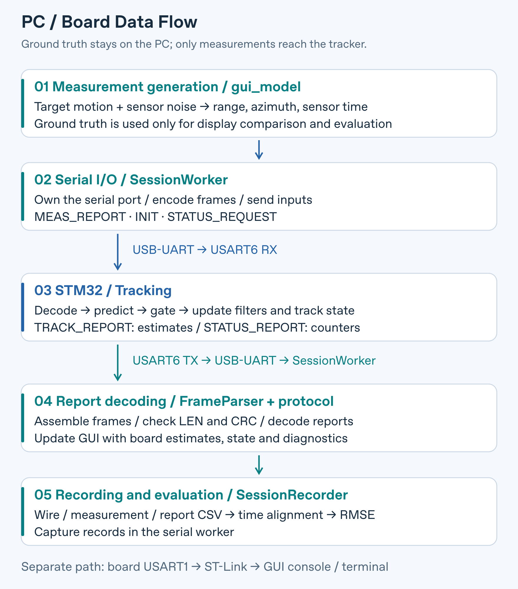
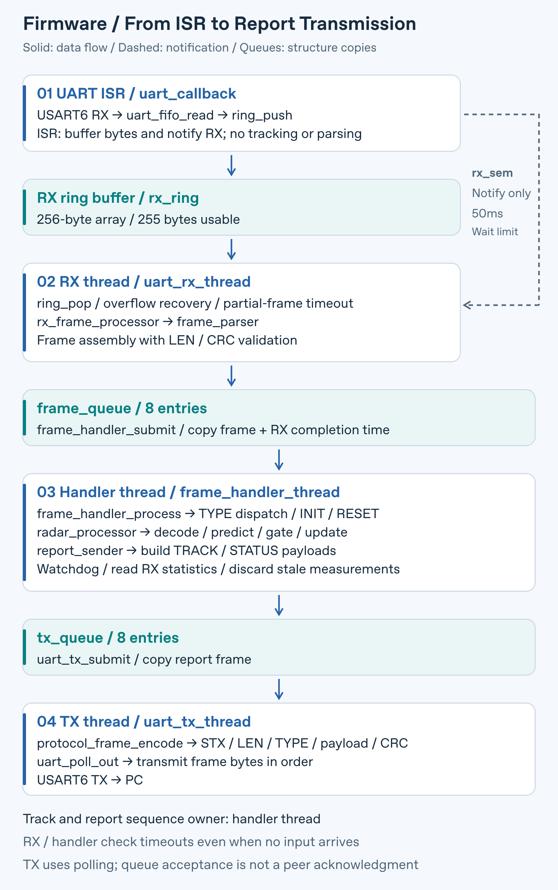

# Architecture and data flow

**English** | [한국어](EXPLAINER.md)

[Project overview](README.md) · [Board results](README.md#board-results) · [Documentation index — Korean](docs/README.md)

This guide describes the implemented V1 single-target path: synthetic measurements on the PC, tracking on the STM32, and binary results returned for evaluation. Source links identify the modules behind each responsibility. Detailed specifications and dated test reports remain in Korean.

## PC and board responsibilities

The PC generates target motion and sensor errors. Range, azimuth, and sensor time are sent to the board; ground truth and scenario target IDs stay on the PC. The firmware performs prediction, gating, filter updates, and track lifecycle management.

The GUI worker owns the data port and uses the same protocol implementation as the CLI. It decodes binary reports, records CSV data, and passes display updates to the GUI. ST-Link carries diagnostic text through a separate port. GUI graphs use TRACK_REPORT data rather than values scraped from console logs.

The CLI senders `radar_sender` and `run_sim` send measurements only. The GUI and `pc_sim.evaluate` also collect results. Preview mode opens no serial port and produces no simulated board estimates. PC multi-target/clutter generation is available for output-only scenarios; the current board path accepts a single target.

## Execution contexts and state ownership

| Context | Responsibility and owned state | Handoff |
| --- | --- | --- |
| UART ISR | Read USART6 RX bytes, push into the ring, flag overflow and count discarded bytes | Bytes stay in the ring; `rx_sem` only signals work |
| RX thread | Drain the ring, recover overflow, parse frames, check length/CRC and partial-frame timeout | Copy a validated frame and board RX-completion time into `frame_queue` |
| Handler thread | Dispatch TYPE; own the track, measurement watchdog, stale-input count and report sequence | Construct report payloads and submit copies to `tx_queue` |
| TX thread | Encode queued reports and send complete frames through `uart_poll_out` | USART6 TX to the PC |
| Optional perf reporter | Read instrumentation and periodically report counters/stack observations | Diagnostic console |

The RX ring is a 256-byte array with **255 usable bytes**. Both frame queues hold **eight entries**. The handler alone changes tracking state, so RX and TX do not need to coordinate concurrent writes to the filters. Queues copy the frame structures; the sender does not retain a pointer to a producer's temporary payload.

`frame_handler`, `radar_processor`, and `report_sender` are separate modules running in the **same handler thread**. Their separation expresses responsibilities rather than adding threads. The TX thread keeps polling UART output outside the handler path and preserves accepted queue order.

RX and handler waits expire after 50 ms so they can check timeouts even when no new frame arrives. This is a polling interval for timeout checks, not a guaranteed 50 ms end-to-end response time. RX/TX readiness semaphores act as startup barriers.

Sources: [UART RX](fcc_app/src/transport/uart_rx.c), [handler](fcc_app/src/application/frame_handler.c), [radar processor](fcc_app/src/application/radar_processor.c), [report sender](fcc_app/src/application/report_sender.c), [UART TX](fcc_app/src/transport/uart_tx.c).

## Wire contract and reports

Frame layout: `0x7E | LEN | TYPE | PAYLOAD | CRC_H | CRC_L`.

`LEN` counts payload bytes only, from 1 to 32. CRC-16/IBM-3740 covers LEN, TYPE, and payload. Multibyte payload fields and CRC bytes use big-endian encoding.

| Message | TYPE | Role |
| --- | ---: | --- |
| INIT / RESET | 1 / 5 | Clear track and measurement-watchdog state; submit an invalid-estimate RESET event |
| MEAS_REPORT | 2 | PC-to-board measurement input |
| STATUS_REQUEST / STATUS_REPORT | 3 / 6 | Request/return cumulative diagnostic counters |
| TRACK_REPORT | 7 | Return tracking result, state, timestamps, estimates, validity flags and sequence |

COMMAND (TYPE 4) is reserved in the implementation and currently ignored with a log message. Even INIT/RESET requests need at least one payload byte because zero-length frames are rejected.

A MEAS_REPORT payload is 10 bytes (`>IHi` in Python):

| Field | Wire representation | Meaning |
| --- | --- | --- |
| `timestamp_ms` | uint32 | Sender sensor time in milliseconds |
| `range_m` | uint16 | Integer metres; valid measurement range 1–65,535 m |
| `azimuth_sc` | int32 | Signed semicircle angle |

The board converts angle using `azimuth_rad = azimuth_sc × π / 2³¹`. The filters operate in metres and radians. [Protocol frame definitions](fcc_app/src/protocol/protocol_frame.h) · [Measurement decoding](fcc_app/src/protocol/measurement_message.c).

A fresh payload that passes decoding and validation produces a TRACK submission attempt, including when tracking later rejects its timestamp or gate. Invalid payloads and stale queued measurements do not produce measurement reports. Estimates are valid in TENTATIVE, CONFIRMED, and COASTING; EMPTY/LOST reports clear `ESTIMATE_VALID` and zero the estimate fields. Consumers use the validity flag rather than treating numeric zero as invalid.

Report sequence advances for each submission attempt, including failed submissions. INIT/RESET and measurement timeout preserve it. A sequence gap therefore requires diagnosis; it is not sufficient evidence of physical-link loss. Queue acceptance and completed polling writes are not peer acknowledgments.

STATUS returns eight cumulative uint32 counters: CRC errors, length errors, partial-frame timeouts, RX queue drops, ring-overflow events, ISR-discarded bytes, recovery-discarded bytes, and stale queued measurements. Atomic RX counters are read individually and handler-owned values are read in their owner thread. The combined report is not a simultaneous snapshot. INIT/RESET does not clear these counters.

[Exact TRACK layout and flags — Korean](docs/requirements-traceability.md#spec-track-report).

## Tracking and time domains

Range and azimuth each use a constant-velocity Kalman filter. Angular differences are wrapped to the shortest difference. Fixed, inclusive range and azimuth gates must both pass before correction; defaults are ±100 m and ±10°. They are configured through Kconfig.

| Event | Implemented behavior |
| --- | --- |
| First valid measurement in EMPTY | Initialize filters and enter TENTATIVE |
| Three hits, including initial acquisition | Enter CONFIRMED |
| Miss on a confirmed/coasting track | Keep the prediction and enter/remain COASTING |
| Five consecutive misses | Enter LOST |
| Miss in TENTATIVE | Clear the track to EMPTY |
| Duplicate or backward sensor timestamp | Reject the time update |
| Forward sensor-time gap over 1,000 ms | Clear the track; a subsequent measurement starts acquisition again |

A LOST track is cleared on the next prediction attempt; that measurement is not reused for acquisition. A later measurement starts a new track. [Track implementation](fcc_app/src/tracking/track.c).

Three clocks have distinct purposes:

| Time source | Use |
| --- | --- |
| Sender sensor timestamp | Kalman prediction intervals, truth/estimate alignment, spike-recovery evaluation |
| Board uptime | RX completion, queued-input age, no-measurement watchdog, internal timing |
| PC monotonic clock | Host send rate, round-trip latency, GUI report freshness |

The measurement watchdog is armed only after a payload passes decoding and validation. A later gate/time rejection still counts as receipt of a valid payload; STATUS and malformed input do not. After 1,000 ms without another valid payload, the handler clears tracking/watchdog state and submits one RESET event. Reporting is then disarmed until another valid measurement arrives. This is separate from the GUI's 2-second STALE indication, which describes absent fresh reports without changing the board's reported state to LOST.

Queued measurements whose age reaches the measurement-timeout threshold are discarded **before** decoding/tracking. Age is computed from board RX completion, not by subtracting the sender's clock from board uptime. This prevents an old queue backlog from refreshing tracking with stale input.

## Saturation and recovery choices

| Condition | Implemented policy | Tradeoff or boundary |
| --- | --- | --- |
| Partial frame stalls | Expire parser state after the configured frame timeout | Subsequent valid frames can be parsed; a partial message is lost |
| RX ring overflows, default DRAIN | Drop new ISR input, process frames that can be completed from buffered bytes, then reset ring/parser | Preserves usable buffered frames but loses incoming data during recovery |
| RX ring overflows, DISCARD | Reset ring/parser without draining buffered frames | Simpler recovery with more buffered-data loss |
| Handler queue full | Nonblocking submission fails and is counted | INIT/RESET share the queue and can also be dropped |
| TX queue full | Nonblocking submission fails; tracking state is not rolled back | Not every generated report reaches the PC |

IRQ-locked regions are kept short around ring access/recovery reset. Parsing, tracking and queue submission run outside the IRQ lock. Ring recovery does not flush the hardware UART FIFO or guarantee immediate alignment with the next frame boundary.

These policies make overload observable rather than claiming lossless operation under unbounded input. Physical-board records cover forced DRAIN overflow and RX/TX saturation with subsequent recovery. UART overrun/framing/parity diagnostics and the complete DISCARD board-test matrix remain follow-up work.

[Transport stress — Korean](docs/hardware-test-2026-11-18-transport-stress.md) · [Control loss and TX saturation — Korean](docs/hardware-test-2026-11-18-track-controls.md).

## What the measurements establish

| Metric | Start and end | Interpretation |
| --- | --- | --- |
| PC round-trip latency | Immediately before write → immediately after the read containing the matching TRACK | Includes host/USB/UART delays; excludes subsequent parsing and display work |
| Board processing interval | RX frame completion → TX queue submission return | Includes handler queue waiting; excludes later TX queue waiting and UART transmission |
| Spike recovery | First normal sensor input → first sample in a qualifying recovery streak | Sensor-time tracking behavior, not MCU execution time |

The 30-minute load run returned responses for all 89,990 measurements with RTT p99 8.049 ms and maximum 34.894 ms. Its observed maximum internal interval was 1 ms. The original host-spacing failure is preserved, with the later RTT-based interpretation recorded separately.

The 100-run noise sweep varies one axis at a time across 10 conditions and 10 seeds. Its RMSE excludes the first two seconds of each run and summarizes equally weighted per-seed metrics. The 49-run spike suite requires three consecutive current, valid CONFIRMED/UPDATED estimates within 2 m and 0.2° of truth. All 49 cases passed; the longest recovery streak began at 3,100 ms and was confirmed at 3,300 ms of sensor time. In-gate spikes may update the filter, so passing recovery is not a claim that every outlier is immediately discarded.

Python tests cover protocol/scenario/evaluation code and, with GUI dependencies, offscreen Qt behavior. Host C tests exercise firmware modules with simulated RTOS/UART interfaces. They do not reproduce hardware interrupt concurrency or replace board measurements. Observed latency and free-stack values do not establish WCET or maximum sustainable throughput.

[Board-result summary](README.md#board-results) · [Timing contract — Korean](docs/performance-monitoring.md) · [Noise/spike evidence — Korean](docs/hardware-test-2026-11-19-noise-spike.md) · [Test commands — Korean](docs/test-cases.md).

## Source map

| Path | Purpose |
| --- | --- |
| [fcc_app/src/transport](fcc_app/src/transport) | UART RX/TX, ring recovery and RX frame processing |
| [fcc_app/src/protocol](fcc_app/src/protocol) | Frame parsing/encoding and measurement/report formats |
| [fcc_app/src/application](fcc_app/src/application) | Handler ownership, tracking orchestration and report submission |
| [fcc_app/src/tracking](fcc_app/src/tracking) | CV filters, gates, angle handling and track lifecycle |
| [fcc_app/src/diagnostics](fcc_app/src/diagnostics) | Optional performance collection and reporting |
| [pc_sim](pc_sim) | GUI/CLI, measurement generation, report capture and evaluation |
| [fcc_app/tests](fcc_app/tests) / [tests](tests) | Host C / Python verification |

V1 is complete. Multi-target tracking, alternative estimators, additional hardware-error handling and latency optimization are separate follow-up work. [Scope and roadmap — Korean](docs/roadmap.md).

## Estimator execution timing (2026-11-22)

The `perf.conf` build aggregates predict/correct timer cycles separately and reports sample count and minimum/mean/maximum nanoseconds every five seconds. Aggregates are cumulative since boot; empty aggregates report `status=no_samples`. Host tests, firmware builds, and a 10-second STM32 smoke run validate the output path; these are not WCET or long-duration performance guarantees. See the [measurement contract](docs/performance-monitoring.md) for boundaries and limitations.

The [2026-11-22 log-format regression](docs/hardware-test-2026-11-22-logging.md) covers structured console logs and GUI/PC compatibility.
