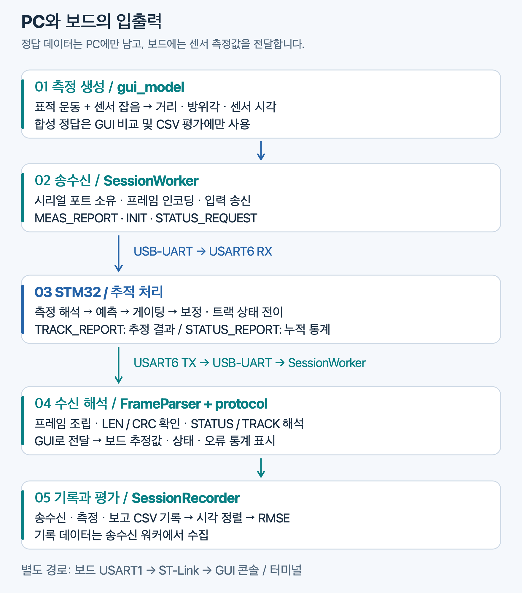
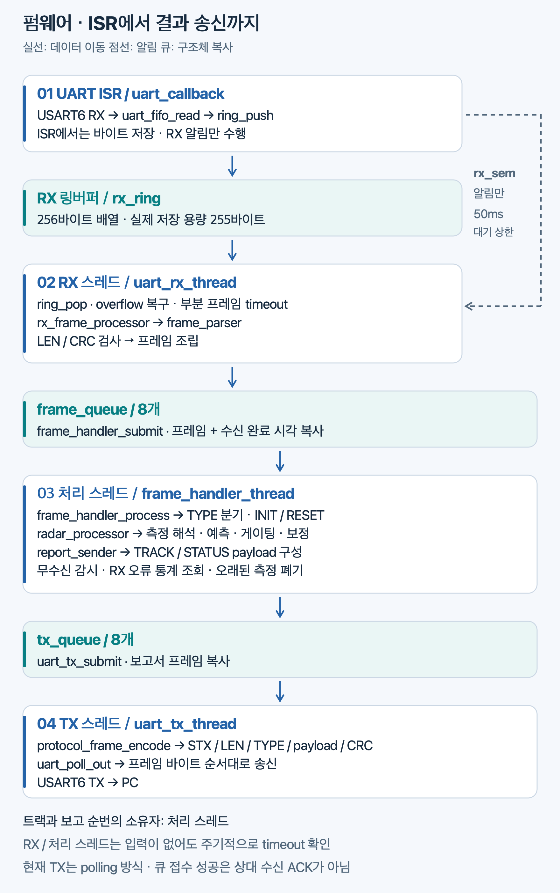

# 구현 구조와 데이터 흐름

[English](EXPLAINER.en.md) | **한국어**

[문서 목차](docs/README.md) · [프로젝트 소개](README.ko.md)

이 문서는 V1 단일 트랙 구현을 설명합니다. 실행 명령은 [pc_sim 안내](pc_sim/README.md),
배선은 [배선·보드 검증](docs/board-bringup.md)를 참고하세요.

## 입출력과 시스템 연결

PC는 측정 입력을 만들고, STM32는 추적 계산을 수행해 결과를 반환합니다.
아래는 GUI 보드 모드의 현재 연결입니다. 합성 실제값은 비교 기준으로 PC에만 남습니다.



데이터와 진단 콘솔은 별도 포트입니다. GUI와 CLI가 같은 포트를 동시에 열지 않습니다.
CLI 송신기(`radar_sender`, `run_sim`)는 측정 송신만 수행합니다. GUI와 `python -m pc_sim.evaluate`는 TRACK 수집·CSV 저장을 지원합니다.

## 펌웨어 내부 처리 흐름

실선은 데이터 전달, 점선은 세마포어 알림을 나타냅니다. ISR은 바이트를 저장하고 RX 스레드를 깨우며,
파싱·추적 계산·보고서 구성은 스레드 문맥에서 수행합니다.



STATUS 구성 시 RX 오류·드롭 통계는 atomic 카운터를 개별 조회하고, 오래된 측정 통계는 처리 스레드가 소유한 값을 사용합니다. 전체 통계의 동시 snapshot을 보장하지는 않습니다.

트랙과 보고 순번은 처리 스레드가 소유합니다. 큐는 구조체를 복사하고, 세마포어는 바이트를 전달하지 않습니다.
RX/handler는 입력이 없어도 주기적으로 깨어 timeout을 확인합니다. TX는 현재 polling 방식이며 TX ISR/DMA를 사용하지 않습니다.
큐 접수·UART write 성공은 상대 수신 ACK가 아닙니다. INIT/RESET·무수신 timeout은 무효 TRACK 초기화 보고를 한 번 제출합니다. 기본 실보드 왕복을 확인했습니다.

## 1. PC 측정 생성

`pc_sim/radar_sender.py`는 거리 변화율과 잡음으로 간단한 측정을 생성합니다.
`pc_sim/run_sim.py`는 `targets.py`의 직교좌표 표적을 움직이고 센서 모델로 측정을 생성합니다.
두 실행기는 `protocol.py`의 동일한 프레임 생성 함수를 사용합니다.

시나리오의 물리량은 거리 m, 각도 rad입니다. 송신 직전에 거리를 정수 m로 반올림하고
각도를 signed int32 semicircle로 변환합니다. 앙각·도플러는 모델 내부에만 남습니다.
다중표적·클러터 생성은 PC 출력에서 가능하지만 현재 보드 전송에는 단일 표적만 허용합니다.
`--port` 생략은 프레임 출력이며 보드 추적기의 모사가 아닙니다.

### 데스크톱 GUI

`python -m pc_sim.gui`는 기존 CLI와 함께 사용하는 PySide6/pyqtgraph 앱입니다.
`gui_model.py`는 단일표적 설정·측정 생성, `gui_worker.py`는 작업 스레드에서 포트 소유·송신·STATUS 수신·콘솔 읽기를 담당합니다.
`gui.py`는 signal로 전달된 데이터를 화면에 표시합니다. 미리보기는 시리얼 포트를 열지 않습니다.
송신을 중지해도 콘솔 연결은 유지하며, 재시작할 때 INIT을 먼저 보냅니다.
GUI는 합성 실제값·PC 측정값과 TRACK_REPORT로 받은 보드 추정값을 구분해 표시합니다. 미리보기에서는 보드 추정값을 만들지 않습니다.
설치·실행·검증 한계는 [GUI 안내](pc_sim/GUI.md)에 정리했습니다.

## 2. 통신 규격

```text
7E | LEN | TYPE | PAYLOAD | CRC_H | CRC_L
```

LEN은 payload 길이 1..32바이트이고 CRC 범위는 LEN·TYPE·payload입니다.
FRAME_TYPE_MEAS_REPORT=2의 payload는 `>IHi` 10바이트입니다.

| 필드 | 크기 | 의미 |
|---|---|---|
| timestamp_ms | 4바이트 | 송신 측 uint32 시간(ms) |
| range_m | 2바이트 | uint16 거리(m), 유효 범위 1..65535 |
| azimuth_sc | 4바이트 | signed int32 semicircle |

보드 변환식은 `azimuth_rad = azimuth_sc × π / 2³¹`입니다.
FRAME_TYPE_INIT=1은 이전 트랙을 초기화합니다. payload 길이 0은 파서가 거부하므로
수동 INIT에도 문자열 등 최소 1바이트를 넣습니다.
두 연속 송신기는 매 실행 시 `7e 01 01 00 c8 9d` INIT 프레임을 한 번 보낸 뒤 측정을 시작합니다.
자동 INIT의 payload는 더미 바이트 `0x00`입니다. 출력 전용 모드에서도 INIT이 먼저 표시됩니다.

## 3. UART 수신

`uart_callback()`은 인터럽트에서 바이트를 링버퍼에 넣고 `rx_sem`으로 수신 스레드를 깨웁니다.
실제 데이터는 링버퍼에 있고 세마포어는 알림입니다.
`rx_ready_sem`은 링버퍼·파서 초기화가 끝나기 전 처리를 막습니다.

`uart_rx_thread()`는 RX 알림 또는 50ms 대기 만료 후 실행됩니다.
IRQ 잠금 안에서는 overflow 확인과 한 바이트 pop만 수행합니다.
잠금을 해제한 뒤 `rx_frame_processor_feed()`로 파싱하고, 정상 프레임을 handler 큐에 복사합니다.
안쪽 배출 루프가 끝나면 부분 프레임 timeout을 검사합니다.
별도 handler 스레드가 큐를 받아 `frame_handler_process()`을 호출하고 측정 timeout을 검사합니다.

### 버퍼와 overflow

소프트웨어 링버퍼는 256바이트이며 한 칸을 비워 실제로 255바이트를 저장합니다.
head/tail은 `uint8_t`로 0..255를 표현합니다. 버퍼를 256보다 크게 늘리려면 인덱스 타입도 바꿔야 합니다.

ISR에서 `ring_push()`가 실패하면 해당 바이트를 버리고 `rx_overflow`를 설정한 뒤
`rx_sem`으로 스레드에 알립니다. 플래그가 설정된 동안 ISR은 하드웨어 FIFO를 읽되 새 바이트는 저장하지 않습니다.
파싱과 큐 제출은 IRQ 잠금 밖에서 실행되며, 실제 측정 처리는 handler 스레드가 맡습니다.

현재 `uart_rx.c`가 Kconfig 선택을 매핑한 `RX_OVERFLOW_POLICY`는 `RX_OVERFLOW_POLICY_DRAIN_BUFFER`입니다.
복구는 IRQ를 허용한 상태에서 기존 파서와 버퍼로 완성할 수 있는 프레임을 처리합니다.
마지막에 짧게 IRQ를 잠그고 링버퍼·부분 프레임을 초기화한 뒤 overflow를 해제합니다.
`RX_OVERFLOW_POLICY_DISCARD_ALL`을 선택하면 drain 없이 바로 초기화합니다. `fcc_app/Kconfig` choice와 `prj.conf`로 선택하며 기본값은 DRAIN입니다.
복구 중 새 입력은 손실되며, 초기화는 하드웨어 FIFO를 비우거나 다음 프레임 경계 정렬을 보장하지 않습니다.

## 4. 측정과 추적

`frame_handler`는 MCU 수신 완료 후 경과가 측정 timeout 이상인 MEAS_REPORT를 먼저 폐기합니다. 이때 트랙·수신 감시·보고 순번은 갱신하지 않고 포화 카운터만 증가시킵니다.

`frame_handler`는 TYPE을 분기하고 `radar_processor_process_measurement()`에 측정을 전달합니다.
트랙·마지막 유효 수신 시각·감시 상태는 `frame_handler.radar`에 있으며 `radar_processor`가 갱신합니다.
별도 스레드를 만든 것이 아니라 기존 handler 스레드 안에서 책임을 분리한 것입니다.

`measurement_message_decode()`와 `measurement_message_validate()`를 통과한 측정은
보드 uptime 기반 마지막 수신 시각을 갱신합니다. 송신 timestamp와 보드 uptime은 서로 다른 시계입니다.

- EMPTY이면 `track_start()`로 필터를 초기화하고 TENTATIVE가 됩니다.
- 기존 트랙이면 송신 timestamp 차이로 예측하고 게이트를 검사합니다.
- 게이트 통과는 `track_hit()`, 탈락은 `track_miss()`로 처리합니다.
- 3회 hit로 CONFIRMED, 확정 트랙의 miss는 COASTING, 연속 5회 miss로 LOST가 됩니다.
- TENTATIVE에서 miss면 EMPTY로 초기화합니다.
- 중복·역행 timestamp는 거부합니다. 순방향 간격 1000ms 초과는 트랙을 초기화합니다.

## 5. 무수신 timeout

정상 레이더 측정을 처리한 이후 `CONFIG_RADAR_MEASUREMENT_TIMEOUT_MS`(기본 1000ms) 이상 새 정상 측정이 없으면 radar processor의 트랙·감시 상태를 초기화합니다. 보고 순번은 보존합니다.
첫 정상 측정 전에는 감시하지 않으며, timeout 후에는 다음 정상 측정까지 감시를 해제합니다.
STATUS나 잘못된 패킷은 수신 시각을 갱신하지 않습니다.
게이트 또는 timestamp 검사에서 거부된 측정도 decode·validate를 통과했다면 수신 시각은 갱신합니다.
이는 필터 보정 성공 여부가 아니라 정상 측정 payload의 수신 중단을 감시하는 정책입니다.

## 6. 검증의 범위

Python 테스트는 프레임 바이트·단위 변환·송신 순서·시나리오 CLI와 GUI 모델을 검증합니다.
GUI 의존성을 설치하면 offscreen Qt·모사 serial로 시작·중지·재시작·오류·포트 해제도 검사합니다.
`fcc_app/tests/test_tracking`은 C 필터·게이팅·추적 정책 등의 별도 테스트입니다.
[UART host 테스트](fcc_app/tests/test_uart_rx/README.md)는 실제 ISR·복구·링버퍼·파서·timeout·통계를 drain 24·discard 21, 총 45회 실행으로 검증합니다.
UART·IRQ·atomic·시각·handler는 모사하며 무한 RX 스레드를 실제로 스케줄링하지 않습니다.
이 테스트들은 새 펌웨어 빌드나 실제 UART HIL 성공을 대신하지 않습니다.
펌웨어의 측정별 TRACK_REPORT 경로를 구현했고 PC 해석·GUI 비교는 모사 UART로 확인했습니다. CSV·고정 시나리오 실보드 RMSE와 실제 UART GUI를 확인했습니다. [결과](docs/hardware-test-2026-11-18-evaluation.md).
구버전 LCD·다중 트랙 문서는 제거했으며 과거 기록은 Git 이력에서 확인할 수 있습니다.


## 7. STATUS 응답 송신

`rx_frame_processor.c`가 CRC·길이 오류·부분 프레임 timeout·큐 드롭의 atomic
카운터를 소유합니다. `report_sender_submit_status()`는 처리 스레드에서 지역 `stats`로 값을 복사해
이진 응답에 사용하고 콘솔에는 큐 접수 여부만 DEBUG로 기록합니다. 개별 값은 안전하게 읽지만 전체 항목을 같은 순간에
고정하지는 않습니다. 조회·parser reset·INIT/RESET은 누적 카운터를 지우지 않습니다.
`uart_rx.c`는 overflow 진입 횟수·ISR 폐기 바이트·복구 시 링 폐기 바이트를 별도로 소유합니다.
하드웨어 BIT 결과나 UART 하드웨어 오류는 아직 제공하지 않습니다.

`uart_tx.c/.h`는 초기화·TX 복사 큐·스레드와 polling 송신을 구현했습니다.
`protocol_frame_encode()`가 STX·LEN·TYPE·payload·CRC 바이트열을 구성합니다.
STATUS 처리부는 processor의 네 통계, UART의 세 통계, handler의 stale_measurements를 big-endian uint32로 인코딩한 32바이트
STATUS_REPORT를 TX 큐에 복사 제출합니다. 순서는 CRC 오류·길이 오류·부분 프레임
timeout·큐 드롭·링 overflow 횟수·ISR 폐기 바이트·복구 폐기 바이트·오래된 측정 폐기입니다. 인코딩·큐 제출 실패는 오류 코드와 함께 로그로 남깁니다.
`frame_parser.py`가 PC 수신 프레임을 조립·검증하고 `decode_status_payload()`가 통계를 해석합니다.
`status_client.py`는 CLI 왕복을, GUI의 STATUS 탭은 기존 worker를 통한 수동 조회를 제공합니다.
둘 다 host 모사 시험을 통과했으며 [확장 STATUS 실보드 시험](docs/hardware-test-2026-11-14-status-extended.md)에서 CLI·GUI STATUS 왕복도 확인했습니다.
TX host 테스트 4개와 CRC/인코더 상호운용 34개를 통과했으며 실보드 STATUS 송신도 확인했습니다. 이후 [TX 포화·제어 시험](docs/hardware-test-2026-11-18-track-controls.md)과 [30분 부하 시험](docs/hardware-test-2026-11-19-performance.md)을 기록했습니다. 최대 지속 처리율을 확정한 것은 아닙니다.
handler host 테스트 31개는 STATUS·TRACK 응답·실패 복귀, INIT/RESET과 정상·잘못된 측정의 timeout 영향 및 processor 계약을 검증합니다.
host 통계 snapshot은 모사합니다. 실보드에서는 CRC/LEN/부분 프레임 timeout 집계와
INIT/RESET 후 보존을 확인했습니다. 기본 DRAIN의 강제 링 overflow와 RX/TX 큐 포화 후 복귀는 [전송 오류 시험](docs/hardware-test-2026-11-18-transport-stress.md)에서 확인했습니다. 전체 동시성·UART 하드웨어 오류 검증으로 확대하지 않습니다.

## 8. TRACK_REPORT 결과 송신

`radar_processor_process_measurement()`가 유효 payload를 처리하면 입력 시각과 처리 결과를 반환합니다.
`frame_handler`는 `report_sender_submit_track()`을 호출하고, sender가 추적 상태를 32바이트
`track_report`로 구성해 `track_message_encode()` → `uart_tx_submit()`에 전달합니다.
게이트/시각 거부도 보고하며 payload 자체가 무효이면 보고하지 않습니다.

추정값은 TENTATIVE/CONFIRMED/COASTING에서만 유효합니다. EMPTY/LOST이면 추정 시각·수치 필드를 0으로
채우고 ESTIMATE_VALID를 지웁니다. 0이라는 숫자만 보고 유효성을 판단하면 안 됩니다.
순번은 제출 시도마다 증가하므로 인코딩·큐 실패도 소모합니다. INIT/RESET·무수신 timeout은 순번을 보존합니다.
큐 접수는 실제 송신 완료나 PC 수신을 보장하지 않습니다.

INIT/RESET·무수신 timeout은 INPUT_PRESENT=0, ESTIMATE_VALID=0인 RESET 보고를 한 번 제출합니다. PC TRACK 디코더·그래프는 구현했고, 새 보고가 2초 동안 없으면 PC STALE로 표시합니다.
이는 보드 LOST 판정과 별개이며 CSV 원시 로그·정량 평가도 지원합니다. [정확한 배치·플래그·결과 규격](docs/requirements-traceability.md#spec-track-report)을 참고하세요.

## 9. 설정과 검증 기록

게이트는 Kconfig의 거리/각도 상한을 모두 포함 경계로 검사합니다. π는 `common/math_constants.h`를 공유합니다.
각도 정규화는 `fmodf`와 범위 보정으로 (-π, π]를 유지하며 비정상 innovation covariance는 보정을 생략합니다.
내부 유한성 assert는 디버그에서 활성화합니다. [설정](docs/board-bringup.md#주요-설정) · [로깅](docs/logging.md).

날짜·commit별 실보드 결과와 원시 로그는 [검증 이력](docs/verification-history.md)에 모읍니다.
과거 STATUS·로그 부하 시험이 현재 TRACK_REPORT 경로의 실보드 검증을 대신하지 않습니다.

## 파일 구조

```text
fcc_app/src/
    main.c            초기화·진입점
    transport/        uart_rx, uart_tx, rx_frame_processor
    protocol/         frame_parser, protocol_frame, measurement_message, status_message, track_message
    application/      frame_handler(큐·분기), radar_processor(추적), report_sender(보고서 구성·제출)
    tracking/         track, kalman_cv, gating, angle_utils
    common/           crc16, ring_buffer, math_constants, byte_order
    diagnostics/      선택적 perf_monitor(집계), perf_reporter(요약·스택 조회)
fcc_app/tests/
    test_uart_rx/      UART drain·링버퍼·부분 프레임 timeout
    test_frame_handler/ STATUS·TRACK·INIT/RESET·측정 timeout·processor 계약
    test_uart_tx/      TX 큐·인코딩·송신 순서
    test_perf_monitor/ 시간·큐 통계, 동시 snapshot, 요약·스택 조회 모사
    test_tracking/       필터·게이팅·추적 C 회귀 테스트
    log_stress/        별도 로그 부하 시험 도구(대상 버전 확인 필요)
pc_sim/
    gui.py             데스크톱 화면·실시간 그래프
    gui_worker.py      시리얼 소유·송수신·콘솔 작업 스레드
    frame_parser.py    PC 수신 프레임 조립·CRC 검증
    status_client.py   STATUS 요청·응답 CLI
    recording.py       세션 CSV 저장·시각 정렬 RMSE
    evaluate.py        정상·잡음·연속 누락 보드 평가 CLI
    gui_model.py       설정·측정 생성·TRACK 이력/수신 신선도
    protocol.py        공통 프레임 생성·단위 변환·STATUS/TRACK 해석
    radar_sender.py    간단한 거리 변화 측정 송신
    frame_sender.py 단일 프레임 송신·수동 INIT
    targets.py         표적·센서 모델
    run_sim.py         시나리오 출력·UART 송신
    README.md          실행·옵션·제약
tests/                Python 프로토콜·송신기·시나리오 테스트
```

## Estimator 실행 시간 계측 (2026-11-22)

`perf.conf`에서 predict/correct의 실행 cycle을 별도로 누적하고 5초 요약에 표본 수와 최소·평균·최대 ns를 출력합니다. 표본이 없으면 `status=no_samples`를 출력합니다. host/빌드와 STM32 10초 smoke에서 새 출력을 확인했습니다. WCET나 장시간 성능 보장은 아닙니다. [계측 범위·단위·한계](docs/performance-monitoring.md)를 따릅니다.

[2026-11-22 로그 형식·GUI/PC 실보드 회귀](docs/hardware-test-2026-11-22-logging.md)를 참고하세요.
