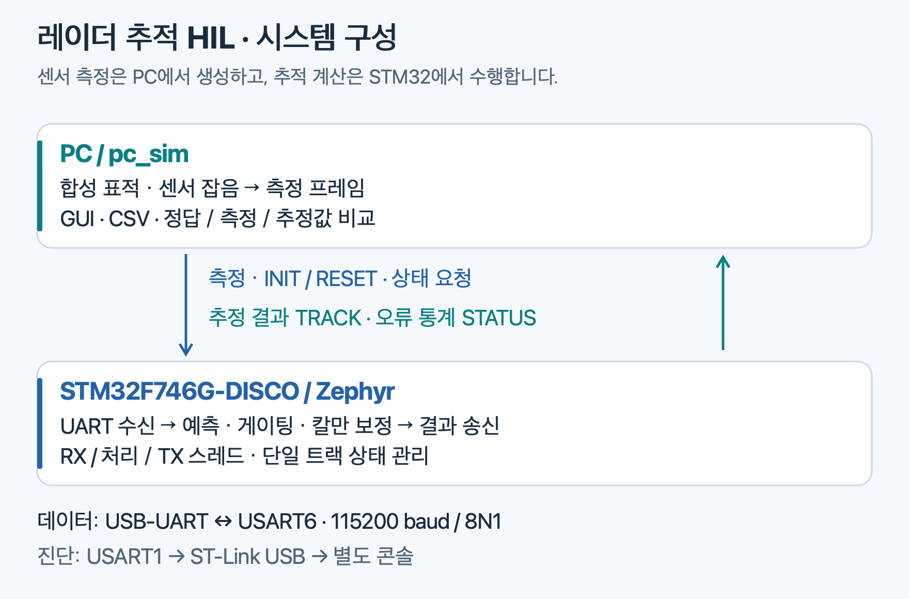

# radar-track-fcc-hil

**STM32 · Zephyr 기반 단일표적 레이더 추적 HIL 프로젝트 — V1 완료 (`v1.0.0`)**

PC에서 합성 레이더 측정을 보내고, STM32에서 표적을 추적한 뒤 결과를 PC로 반환합니다.
정답·측정값·추정값을 비교하고, 통신 오류와 입력 이상치 이후의 복귀를 실보드에서 검증합니다.

[시작하기](#시작하기) · [구현 구조](EXPLAINER.md) · [검증 결과](#검증-결과) · [문서 목차](docs/README.md)

## 시스템 구성



PC는 추적 전 센서 측정을 모사합니다. **예측·게이팅·칼만 필터·트랙 상태 관리는 펌웨어가 담당**하며, PC의 정답 데이터는 결과 비교에만 사용합니다.

| 구성 | 주요 기능 |
|---|---|
| 펌웨어 | UART ISR·링버퍼, RX/처리/TX 스레드, CRC-16, 거리·방위각 CV 칼만 필터, 트랙 생성·유지·소실 |
| 오류 처리 | 부분 프레임·무수신 timeout, overflow 복구, 오래된 측정 폐기, 누적 오류 통계 |
| PC 도구 | GUI·CLI, 측정·잡음·이상치 생성, STATUS/TRACK 수신, CSV 기록·정량 평가 |

ISR·큐·스레드의 연결과 데이터 소유권은 [구현 흐름](EXPLAINER.md), PC와 보드의 책임은 [시스템 역할](docs/system-roles.md)에 정리했습니다.

## GUI 미리보기


현재 코드의 **보드 없는 미리보기 모드**입니다. 합성 정답과 측정값을 표시하며 보드 추정값은 생성하지 않습니다.
[GUI 사용법·TRACK 화면](pc_sim/GUI.md) · [실보드 추정값 캡처와 시험 기록](docs/hardware-test-2026-11-18-evaluation.md)

## 검증 결과

아래 결과는 서로 다른 시험 조건에서 얻은 관측값입니다. 상세 조건과 원시 기록은 각 링크에서 확인할 수 있습니다.

| 시험 | 확인한 결과 | 상세 |
|---|---|---|
| 30분 송수신 | 목표50Hz, 실제49.994Hz. 측정 **89,990개 모두 대응** | [성능 기록](docs/hardware-test-2026-11-19-performance.md) |
| 왕복 지연 | 위 부하에서 PC RTT **p99 8.049ms · 최대34.894ms** | [측정 경계·기준](docs/performance-monitoring.md) |
| 이상치·복귀 | 단발·5연속 거리/각도 이상치 **49/49회 통과** | [실보드 평가](docs/hardware-test-2026-11-19-noise-spike.md) |
| 잡음·정확도 | **100회** 잡음/seed 평가, 측정·추정 RMSE와 게이트 거부율 기록 | [조건별 결과](docs/hardware-test-2026-11-19-noise-spike.md#잡음100회) |
| 오류 복구 | CRC·부분 프레임, 데이터 선 단절·복원, 링버퍼·큐 포화 후 복귀 | [검증 이력](docs/verification-history.md) |

PC RTT는 USB·UART·보드·호스트 대기를 포함합니다. 30분 기록의 관측값은 현재 RTT 예산 이내이지만, 당시 호스트 송신 간격 기준에 따른 실패 판정은 이력에 보존했습니다. 조건·판정 변경과 적용 범위는 [완료 기준](docs/roadmap.md#v1-acceptance)을 따릅니다.

## 시작하기

기준 환경은 **STM32F746G-DISCO · Zephyr 4.2 · Zephyr SDK 0.17.2**입니다.
보드 연결과 펌웨어 빌드·플래시는 [보드 시작 안내](docs/board-bringup.md)를 따릅니다.

PC 도구는 저장소 루트에서 실행합니다. 아래는 준비된 Zephyr Python 환경을 사용하는 예입니다.
GUI의 미리보기 모드는 보드 없이 실행할 수 있습니다.

```bash
source ~/zephyrproject/.venv/bin/activate
python -m pip install -r pc_sim/requirements-gui.txt
python -m pc_sim.gui
```

- [GUI 사용법](pc_sim/GUI.md): 미리보기, 보드 연결, 측정·추정 그래프, 상태 조회
- [CLI·평가 도구](pc_sim/README.md): 측정 송신, CSV 수집, 잡음·이상치 시험
- [자동 테스트](docs/test-cases.md): Python 및 C host 테스트 실행 방법과 범위

## V1 범위

<a id="portfolio-v1"></a>
<a id="v1-acceptance"></a>

**단일표적 결과 왕복·정량 평가·주요 오류 복구·시간/자원 관측까지 완료했습니다.**
다중표적·BIT·Lock On은 후속 확장입니다. 실제 RF 신호처리와 실운용 인증은 프로젝트 범위에 포함하지 않습니다.
[완료 범위와 후속 과제](docs/roadmap.md)를 참고하세요.

문서는 [사용·설계·검증·개발 기록](docs/README.md)으로 나누어 안내합니다. 날짜별 시험 기록에는 당시 버전·설정·한계를 보존합니다.

## 개발 방식

문제 정의·구조·검증 기준과 STM32/Zephyr 펌웨어는 직접 설계·작성했습니다.
PC 시뮬레이터와 GUI 구현에는 AI 코딩 에이전트를 활용했습니다.
모든 입력은 합성 측정 데이터이며 실제 군 운용 데이터나 내부 시스템 정보를 사용하지 않습니다.
