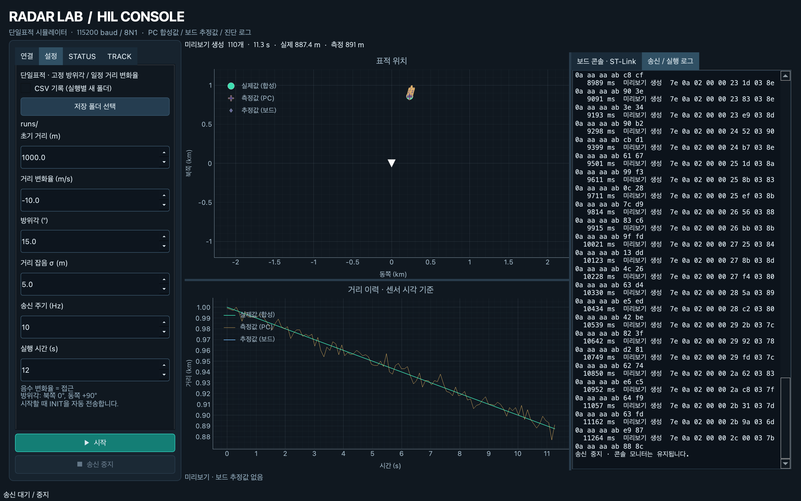

# radar-track-fcc-hil

STM32 + Zephyr RTOS 기반 레이더 추적 학습 프로젝트입니다. 현재 구현은 단일 트랙과 UART 측정 수신이며, PC 시뮬레이터로 보드 시험을 진행합니다.
PC가 합성 표적·측정값을 생성하고 STM32가 추적 결과를 반환해 RMSE와 트랙 연속성 같은 지표로 검증하는 구조를 목표로 합니다.

> **개발 방식**  
> 문제 정의, 요구사항, 시스템 구조와 검증 기준을 직접 설계하고, STM32/Zephyr 펌웨어는 직접 작성하며 학습하고 있습니다. PC 시뮬레이터와 GUI 구현에는 AI 코딩 에이전트를 활용하며, 결과를 검토하고 실제 보드와 연결해 검증합니다. 이 저장소는 합성 측정 데이터를 사용하는 실험용 HIL 시스템이며 실제 군 운용 데이터나 내부 시스템 정보를 사용하지 않습니다.

```text
pc_sim (Python 측정 생성)
  → CRC-16 프레임 / USB-UART
  → STM32 RX: uart_rx → rx_frame_processor → frame_parser
  → 메시지 큐 → frame_handler 스레드 → track / Kalman
  → ST-Link 콘솔에서 결과 확인
```

## 시스템 역할

**PC는 추적 전 레이더 탐지 측정 출력을 모사하고, STM32는 그 측정으로 표적을 추적하는 컴퓨터입니다.**
이미 추적을 끝내고 안정적인 target ID를 제공하는 레이더 장비를 입력으로 가정하지 않습니다.

- `pc_sim`: 합성 표적에서 시간·거리·방위각 측정을 생성합니다. 실제 RF 신호처리를 구현하지 않습니다.
- 펌웨어: 예측·게이팅·칼만 필터·트랙 상태 관리를 담당합니다.
  다중표적 확장 시 측정-트랙 연관과 `track_id` 부여도 펌웨어에서 구현합니다.
- GUI: 시험 제어와 PC 합성값·보드 로그 표시를 담당합니다.
- PC의 정답 `target_id`는 내부 시뮬레이션·향후 평가용이며 측정 payload로 보내지 않습니다.

현재는 단일 트랙이며 **다중표적 연관·트랙 ID 관리·보드 추정 결과 반환은 미구현**입니다.
역할 경계와 ID 정책은 [시스템 역할 문서](docs/system-roles.md)를 기준으로 합니다.

2026-11-15 계획 조정: **단일표적 결과 반환·오차 비교·시간/자원 측정·오류 복구까지 확인한 v1**을 먼저 완성합니다. 다중표적은 v2 후보이며 현재 구현 여부와 별개입니다. [v1 검증 및 완료 기준](#v1-acceptance)을 완료 범위의 기준으로 사용합니다.

## 개발 환경

| 항목           | 값                           |
| -------------- | ---------------------------- |
| 보드           | STM32F746G-DISCO (Cortex-M7) |
| RTOS           | Zephyr v4.2                  |
| SDK            | `~/zephyr-sdk-0.17.2`         |
| west workspace | `~/zephyrproject`            |

개인 `.vscode/` 설정은 추적하지 않습니다. [VS Code 사용 안내](tools/vscode/README.md)는
컴파일 데이터베이스 연결 방법을 설명하며, 빌드·테스트는 에디터 없이도 실행할 수 있습니다.

## PC 도구

측정 송신기·시나리오·STATUS CLI는 `pc_sim/`에 있습니다. [실행 방법과 옵션](pc_sim/README.md)을 참고하세요.

```bash
source ~/zephyrproject/.venv/bin/activate

# 저장소 루트, 보드 없이 현재 프레임 출력
python pc_sim/radar_sender.py --count 3 --noise 0
python -m pc_sim.run_sim --duration 1 --noise 0 --azimuth-noise 0

# 실제 UART: 포트는 자신의 어댑터 이름으로 변경
python pc_sim/radar_sender.py --port /dev/cu.usbserial-A5069RR4 --count 20 --noise 0

# 자동 테스트: 보드 연결·flash 없음
python -m pytest
```

두 연속 송신기는 실행마다 INIT을 한 번 자동 전송한 뒤 timestamp를 0부터 시작합니다. `run_sim.py --port ...`로 시나리오를 보드에 보낼 수도 있습니다.
다중표적·클러터 시나리오는 현재 단일 트랙 펌웨어의 제약 때문에 PC 출력 모드에서만 허용합니다.

전체 Python·C 테스트의 케이스와 검증 범위는 [테스트 케이스 목록](docs/test-cases.md)에 정리했습니다.
요구사항별 규격·구현·테스트·검증 공백은 [요구사항 추적표](docs/requirements-traceability.md)에서 확인합니다.
STATUS 요청·응답 CLI: `python -m pc_sim.status_client --port PORT --timeout 2` — [사용법](pc_sim/README.md#status-진단-요청).

## 데스크톱 GUI

```sh
source ~/zephyrproject/.venv/bin/activate
python -m pip install -r pc_sim/requirements-gui.txt
python -m pc_sim.gui
```

미리보기·실제 UART 송신, 실시간 표적/거리 그래프, ST-Link 콘솔을 지원합니다.
[GUI 실행 안내](pc_sim/GUI.md)를 참고하세요. 그래프는 PC 생성값이며 보드 추정 결과가 아닙니다.



## UART 복구 C 테스트 (보드 불필요)

```bash
cmake -G Ninja -S fcc_app/tests/test_uart_rx -B /tmp/radar-uart-tests
cmake --build /tmp/radar-uart-tests
ctest --test-dir /tmp/radar-uart-tests --output-on-failure
```

실제 수신·복구 코드와 모사 UART를 사용하는 host 테스트입니다.
실행 조건과 검증 한계는 [UART 테스트 안내](fcc_app/tests/test_uart_rx/README.md)를 참고하세요.
Python 테스트와 별도이며 실제 보드 HIL을 대신하지 않습니다.
필터·추적 정책은 [Tracking C 테스트](fcc_app/tests/test_kalman/README.md)로 별도 검증합니다.

TX host 테스트는 [TX 테스트 안내](fcc_app/tests/test_uart_tx/README.md)를 참고하세요.

STATUS·명령·측정 처리 테스트는 [STATUS 테스트 안내](fcc_app/tests/test_frame_handler/README.md)를 참고하세요.

## 펌웨어 빌드·플래시

```bash
cd ~/zephyrproject
west build -d /path/to/radar-track-fcc-hil/build -b stm32f746g_disco /path/to/radar-track-fcc-hil/fcc_app -- -DCMAKE_EXPORT_COMPILE_COMMANDS=ON
west flash -d /path/to/radar-track-fcc-hil/build --runner openocd
```

콘솔은 ST-Link VCP에서 확인합니다. Linux 예: `tio /dev/ttyACM0`.
보드 시험 절차는 [board-bringup.md](docs/board-bringup.md)를 참고하세요.

## 현재 UART 규격

```text
7E | LEN(1) | TYPE(1) | PAYLOAD(LEN) | CRC_H(1) | CRC_L(1)
```

- LEN은 payload 길이이며 1..32바이트. CRC는 LEN·TYPE·payload를 포함하며 상위 바이트부터 전송합니다.
- 측정 payload는 big-endian `>IHi`: timestamp_ms(uint32), range_m(uint16), azimuth_sc(int32), 총 10바이트.
- 방위각은 semicircle: `rad = azimuth_sc × π / 2³¹`. 보드 내부 추정은 라디안입니다.
- TYPE: INIT=1, MEAS_REPORT=2, STATUS_REQUEST=3, COMMAND=4, RESET=5, STATUS_REPORT=6.
- INIT/RESET은 트랙을 초기화합니다. STATUS는 누적 통계를 이진 응답으로 반환하며 DEBUG 로그에는 큐 접수만 기록합니다. COMMAND는 미구현이라 무시 이유를 경고합니다.
  STATUS 통계는 28바이트 STATUS_REPORT(일곱 uint32)로 TX 큐에 제출합니다. PC는 구형 16바이트 응답도 읽으며 없는 필드는 미지원으로 표시합니다.
- 현재 보드는 UART로 이진 트랙 결과를 반환하지 않습니다.

## RX 버퍼와 overflow 복구

`fcc_app/src/common/ring_buffer.h`의 `RING_BUFFER_SIZE`는 **256바이트**, 실제 저장 용량은 **255바이트**입니다.
빈 상태와 가득 찬 상태를 구분하기 위해 한 칸을 비웁니다. `uint8_t` 인덱스는 0..255를
표현하므로 현재 크기에 맞지만, 256보다 크게 늘릴 때는 인덱스 타입도 변경해야 합니다.

현재 `prj.conf`에서 `CONFIG_RADAR_RX_OVERFLOW_DRAIN=y`를 선택하며, `uart_rx.c`에서 이를 `RX_OVERFLOW_POLICY_DRAIN_BUFFER`로 매핑합니다.
정책은 `fcc_app/Kconfig`의 choice로 정의하고 `prj.conf`에서 선택합니다.
버퍼가 가득 차면 실패한 바이트를 버리고 overflow 플래그를 설정합니다. 복구 중 새 입력도
버리며, 기존 파서 상태와 저장된 바이트로 완성할 수 있는 프레임만 처리한 뒤 나머지를 초기화합니다.
`RX_OVERFLOW_POLICY_DISCARD_ALL`은 저장된 바이트와 부분 프레임을 모두 바로 폐기합니다.
두 정책 모두 무손실 수신을 보장하지 않습니다. 실제 overflow 빈도·복구 타이밍은 보드 시험 대상입니다.

CRC 규격은 **CRC-16/IBM-3740 (CCITT-FALSE)**입니다. poly=`0x1021`, init=`0xFFFF`,
refin/refout=false, xorout=`0x0000`이며 `123456789`의 기준값은 `0x29B1`입니다.
규격 이름과 매개변수는 [Zephyr CRC 문서](https://docs.zephyrproject.org/latest/doxygen/html/group__crc.html)와 일치합니다.
STX와 CRC 자체는 계산에서 제외합니다. 측정 프레임은 총 15바이트, INIT은 6바이트입니다.
프로토콜 변경 시 Python 송신기·GUI와 보드 펌웨어를 함께 갱신해야 합니다.

정상 프레임은 깊이 8의 큐에 복사합니다. 큐가 가득 차면 새 프레임을 버리고 누적 드롭을 집계합니다.
INIT/RESET도 큐 포화 시 드롭될 수 있습니다.

## 파일 구조

```text
fcc_app/src/
    main.c            초기화·진입점
    transport/        uart_rx, uart_tx, rx_frame_processor
    protocol/         frame_parser, protocol_frame, radar_message, status_message
    application/      frame_handler: 메시지 처리·추적 실행
    tracking/         track, kalman_cv, gating, angle_utils
    common/           crc16, ring_buffer, math_constants, byte_order
fcc_app/tests/
    test_uart_rx/      UART drain·링버퍼·부분 프레임 timeout
    test_frame_handler/ STATUS·INIT/RESET·측정 timeout
    test_uart_tx/      TX 큐·인코딩·송신 순서
    test_kalman/       필터·게이팅·추적 C 회귀 테스트
tools/vscode/         선택적 VS Code 개발 환경 안내
pc_sim/
    gui.py             데스크톱 화면·실시간 그래프
    gui_worker.py      시리얼 소유·송수신·콘솔 작업 스레드
    frame_parser.py    PC 수신 프레임 조립·CRC 검증
    status_client.py   STATUS 요청·응답 CLI
    gui_model.py       GUI 설정·단일표적 측정 생성
    protocol.py        유일한 프레임 생성·단위 변환
    radar_sender.py    간단한 거리 변화 측정 송신
    small_byte_test.py 단일 프레임 송신·수동 INIT
    targets.py         표적·센서 모델
    run_sim.py         시나리오 출력·UART 송신
    README.md          실행·옵션·제약
tests/                Python 프로토콜·송신기·시나리오 테스트
```

## 구현 범위

| 영역 | 구현된 기능 | 미구현·제한 |
| --- | --- | --- |
| 수신·프로토콜 | UART ISR, 링버퍼, CRC-16·길이 검사, 수신 모듈 분리·부분 프레임 timeout | 스캔 단위 다중 측정 규격 |
| 실행 구조 | RX → 복사 큐 → handler → TX 복사 큐 → TX 스레드, RX 큐 포화 시 드롭 집계 | 추적 결과 송신·실제 큐 동시성 검증 |
| 단일표적 추적 | 거리·방위각 CV 칼만 필터, 게이팅, 트랙 상태·무수신 timeout | 다중 측정 연관, 트랙 테이블·자체 track_id·표적별 수명 관리 |
| 제어·상태 | INIT/RESET 초기화, STATUS로 RX 누적 통계 조회·로그·TX 제출, PC CLI 수신 | TX 부하·장애 검증·BIT·Lock On 미완료 |
| 오류 복구 | drain/discard 정책, CRC·길이 오류 프레임 제외 | 실제 링버퍼 overflow 복구·UART overrun 추가 검증 필요 |
| PC 시뮬레이터 | 측정·잡음 생성, PC 출력용 다중표적·미탐지·클러터 시나리오 | 실제 UART 모드는 단일표적·클러터 0으로 제한 |
| GUI·평가 | 송신 제어, PC 합성값 그래프, 보드 콘솔 | 다중표적 GUI, 보드 추정값 그래프, 폐루프 RMSE·트랙 연속성 평가 |

실제 RF 송수신·ADC/IQ·FFT 신호처리와 완성된 레이더 운용 시스템은 프로젝트 범위 밖입니다.
EKF, Mahalanobis 게이팅, LCD 표시는 현재 미구현이며 우선 TODO에는 포함하지 않습니다.

## 개발 현황과 TODO

체크된 항목은 구현 또는 해당 범위의 검증이 완료된 작업입니다. 구현과 실보드 검증을 따로 표시하며, 하위 항목에 남은 작업을 기록합니다. 아래는 전체 backlog이므로 모든 미완료 항목을 v1 gate로 해석하지 않습니다. v1 필수 범위는 [검증 및 완료 기준](#v1-acceptance), 다중표적·BIT·Lock On 등은 후속 범위입니다.

### 1. 펌웨어 기반·수신 처리

- [x] STM32/Zephyr 빌드·플래시 환경, USART6 입력과 ST-Link 콘솔 구성
- [x] UART callback·링버퍼·세마포어 기반 RX와 256바이트 버퍼 적용
- [x] CRC-16·길이 검증과 parser 결과 구분, PC·펌웨어 규격 통일
- [x] RX/handler 스레드·메시지 큐 분리, rx_frame_processor로 파서 소유·제출 처리 분리
- [x] drain/discard 복구 정책과 큐 포화 드롭 집계 구현
  - [x] 부분 프레임 timeout 구현·host 검증: 바이트 처리 중단 시 parser 초기화·1회 집계·다음 정상 프레임 복구
    - [x] 실제 보드 부분 송신 중단 후 timeout 집계·정상 STATUS 복귀
  - [x] RX 진단 카운터: CRC·길이·부분 프레임 timeout·큐 드롭, atomic 읽기·누적값 보존
  - [x] 링버퍼 overflow 횟수·ISR 폐기 바이트·복구 시 미소비 바이트 폐기 통계와 조회 API, 정책별 host 검증
  - [x] 새 UART 통계의 STATUS_REPORT·PC CLI·GUI 연결, 구형 응답 호환 및 host 검증
  - [x] 확장된 STATUS_REPORT의 실보드 CLI·GUI 왕복
  - [ ] 강제 overflow로 새 카운터 증가·복구 실보드 확인
  - [ ] UART 하드웨어 오류: overrun·framing·parity 감지·집계와 바이트 유실 후 복구
  - [ ] 큐 포화·지연 정책: INIT/RESET 유실, reset 전 대기 측정과 오래된 측정의 처리 기준
  - [x] overflow 정책 Kconfig 분리: DRAIN·DISCARD host 검증 및 두 펌웨어 실보드 UART 회귀
  - [x] timeout 설정 분리: 부분 프레임·측정 무수신 제한을 앱 Kconfig/prj.conf로 관리; 기본값/변경값 host 경계 시험 완료
- [x] 공통 타입·인터페이스 및 코딩 규칙 정리 — [코딩 스탠다드](docs/coding-standard.md) · [적용 결과와 후속 과제](docs/coding-standard-audit.md)
  - [x] `protocol_frame`과 `protocol_frame_is_valid()` 공유; 수신 시각은 `received_frame`에만 유지하고 RX/handler·TX의 submit API·복사 큐는 분리
  - [x] enum 타입 PascalCase·타입명 기반 열거자 접두사 통일; 숫자 값과 로그 문자열 유지, 참조 코드·테스트·문서 갱신
  - [x] 코딩 규칙 문서화·적용: 참조 포인터 `p_`·출력 포인터 `out_`와 선언/정의 인자명, 함수 중괄호·공백·줄바꿈, 직접 사용하는 헤더 include와 불필요 include 정리
  - [x] API 계약 통일: 음수 errno 반환과 Zephyr 오류 전달, CRC 함수의 유효 입력 전제, encode의 바이트 수/음수 오류 반환을 주석으로 명시
  - [x] assert 적용: 링버퍼·wire 길이 제약은 정적 assert로 보호; 내부 불변조건의 런타임 assert는 디버그 빌드에서만 활성화하고 릴리스 입력 검증·오류 처리와 host 테스트 판정은 유지
  - [x] 공통 규격 상수와 주석 정리: STX 중복 정의 제거, 프레임 추가 길이 상수화, 실제 IRQ 보호 범위에 맞는 주석 갱신

### 2. 단일표적 추적

- [x] 10바이트 측정 해석·유효성 검사, semicircle→rad 변환
- [x] 거리·방위각 CV 칼만 필터, 예측·게이팅·보정, 시간 간격 검사
  - [x] 게이트 Kconfig 설정, host 경계 시험·실보드 설정별 수용/거부 검증
- [x] 트랙 생성·확인·coasting·lost 및 재시작 처리
- [x] 첫 정상 측정 이후 무수신 timeout, INIT/RESET과 수신 시각 기반 감시

### 3. PC 시뮬레이터·GUI

- [x] pc_sim으로 도구 통합, 공통 인코더·CLI 송신·시나리오 실행
- [x] 합성 표적 운동·잡음·미탐지·클러터 모델; 다중표적 시나리오는 PC 출력 전용
- [x] GUI 포트·표적 설정, 연결·시작·중지·재시작과 포트 정리
- [x] 설정 탭·스크롤, 표적 위치·거리 이력, 보드 콘솔·송신 로그 배치
  - [ ] v1: 단일표적 보드 추정값·정답·측정 비교와 로그 저장
  - [ ] v2 선택: 다중표적 UART·GUI

### 4. 테스트·실보드 검증·문서

- [x] Python 프로토콜·송신기·GUI 회귀, 실제 C 파서 상호운용 시험, 추적 C 테스트 구축
- [x] UART host C: 링버퍼·CRC/길이 오류·drain·큐 드롭·reset 회귀 시험
- [x] 실제 GUI·보드 연결, 정상 측정·중지/재시작·timeout·오류 후 복귀·큐 burst 시험
- [x] 역할·ID 정책, 배선·빌드·테스트 목록·로그·화면과 블로그 기록 정리
  - [x] 시간 제어 host 시험: 부분 프레임 timeout 경계·무수신·다음 정상 프레임·정상 분할 수신
  - [x] 통계 조회·STATUS host 시험: 출력값, 반복 조회, 트랙·측정 timeout 보존
  - [x] TX host 시험: 큐 복사·FIFO·포화 후 재제출, 인코딩 실패 후 다음 요청 처리; STATUS 제출 실패 후 복귀
  - [x] RX/TX 데이터 선 물리 단절·복원: 무수신/STATUS timeout과 재부팅 없는 정상 왕복·추적 복귀
  - [ ] 큐·동시성 실보드 시험: 포화 시 제어 순서, 오래된 측정, 실제 동시 조회; USB 제거·전원 재인가 등 추가 장애 복귀
  - [x] [로깅 기반](docs/logging.md): 다섯 모듈의 deferred logging, 일반 INFO·디버그 DEBUG, 비차단·새 로그 폐기 설정
  - [x] 로깅 기본 실보드 회귀: 일반/디버그 레벨, 측정·상태 전이·WARN 문장, STATUS·오류·timeout 왕복
  - [x] [로그 강제 포화·측정 부하](docs/hardware-test-2026-11-14-log-stress.md): 유실 알림·STATUS 유지·저속 복귀 확인(최고 실측 평균 157Hz)
  - [ ] 반복 경고 제한·최대 지속 부하·최악 UART 영향·스택 실측
  - [ ] 실보드 링버퍼 overflow/drain·UART overrun·TX 포화/부하 확인
  - [ ] 장시간·고부하·스택 여유·정량 손실 및 추적 정확도 평가

### 5. 다중표적 추적 확장 — v2 선택

- [ ] 입력 규격: 스캔 경계·측정 묶음·상한 설계; PC 정답 target ID는 제외
- [ ] track_manager: 트랙 테이블·펌웨어 자체 ID·표적별 생성/유지/삭제
- [ ] 측정 연관: 예측·게이팅 기반 대응과 미연관 측정·트랙 처리
- [ ] 교차·미탐지·클러터·소실/재등장 검증 및 PC 정답과의 오차·연속성 평가

### 6. 상태·제어·결과 송신

- [x] STATUS 진단: RX 오류·드롭 통계 규격과 응답
  - [x] RX 파싱 통계는 processor, overflow·폐기 통계는 UART 소유, atomic으로 개별 조회; parser·INIT/RESET에서 누적값 보존
  - [x] 처리 스레드의 STATUS 응답 구성과 큐 접수 로그; 전체 항목의 동일 시점 snapshot은 보장하지 않음
  - [x] STATUS 응답 규격: CRC·길이 오류·부분 프레임 timeout·큐 드롭, big-endian uint32 일곱 항목(기존 네 통계 + overflow·ISR 폐기·복구 폐기)
- [ ] v2 선택 — BIT 자기진단: 검사 항목·수행 시점·결과 규격·합격 기준 정의
- [x] TX 송신 기반과 STATUS 왕복: 복사 큐·전용 스레드·프레임 인코딩·PC CLI/GUI 수신
  - [x] TX 초기화·복사 큐·스레드, 프레임 인코딩·CRC·polling 송신 구현과 host 검증
  - [x] STATUS payload 구성과 `uart_tx_submit()` 호출부 연결, host 오류 경로 검증
  - [x] PC STATUS CLI 수신·표시와 오류·deadline 모사 테스트
  - [x] GUI STATUS 수동 조회·통계·성공 시각, 중복 방지·timeout·연결 해제 모사 테스트
  - [x] 실제 보드 → PC STATUS 송신 확인 — CLI·GUI 및 오류 주입 시험
- [ ] 추적 결과 송신·PC 비교: TRACK_REPORT payload·단위·결과 timestamp·송신 주기와 보드 추정값 그래프
  - [ ] 기존 공통 프레임·CRC 인코더를 재사용하고 TX 완료/실패 통계·관측 방식 정의
  - [ ] TX 큐 포화 정책 확장: 현재 새 요청 거부 방식에서 추적 결과·제어 응답의 우선순위·보존·폐기 기준과 오류 집계 정의
- [ ] v2 선택 — COMMAND/Lock On: 트랙 선택·해제·대상 소실 정책

스레드는 표적마다 만들지 않고, 송신 대기 등 독립 실행 요구에 따라 추가합니다.

<a id="portfolio-v1"></a>
<a id="v1-acceptance"></a>

## v1 검증 및 완료 기준 — 2026-11-15

**v1은 PC 측정 입력, 보드의 단일표적 추정, PC 결과 수신과 정량 평가를 연결하고 오류 복구·시간·자원 사용을 검증하는 것을 목표로 합니다.** 아래 완료 기준은 아직 검증 중인 목표이며 달성한 성능을 의미하지 않습니다. 기존 시험 결과는 각 기록의 대상 commit·설정·범위로만 인정합니다.

### 고정 범위

- STM32F746G-DISCO + Zephyr, 기존 UART RX/handler/TX와 단일 트랙 CV·고정 게이트·상태 전이를 사용합니다.
- PC 입력 `MEAS_REPORT`, 보드 추정 출력 `TRACK_REPORT`, 진단 `STATUS_REPORT`는 서로 다른 의미를 갖습니다. TRACK_REPORT는 현재 미구현이며 수치 TYPE·바이트 배치·주기는 첫 작업에서 C/Python 규격에 확정합니다.
- 기존 동작을 깨뜨리는 단위·시각·메모리·상태/복구 결함은 수정합니다. 알고리즘과 통신 기술의 종류를 늘리는 것을 완료 조건으로 삼지 않습니다.

### 완료 체크리스트

| Gate | 끝내기 위해 필요한 증거 | 현재 상태 |
| --- | --- | --- |
| V1-1 결과 왕복 | 추정 거리·방위각·트랙 상태·기준 시각/유효성 반환. PC에서 정답·측정·보드 추정을 대응시켜 그래프와 원시 로그로 보존 | 결과 반환·평가 미구현 |
| V1-2 추적 평가 | 고정 seed의 정상·잡음·연속 누락 시나리오. 최신 측정값 baseline 대비 거리/방위각 RMSE, 상태 전이·복귀 기록. 평가 시각·warm-up·각도 wrap 처리 명시 | 보드 정량 평가 미완료 |
| V1-3 오류 복구 | CRC/부분 프레임, RX/TX 단선·복원, 기본 DRAIN의 강제 링 overflow 및 RX/TX 큐 포화 후 정상 추적 재개. 유실 집계와 INIT/RESET 전후 순서·재개 절차 명시 | 기존 부분 시험 있음. 결과 반환을 포함한 최종 회귀·강제 overflow/TX 포화 남음 |
| V1-4 시간·자원 | 선언한 부하의 30분 실행 로그. 보드 지연 분포·예산 초과 횟수, 송수신/처리/폐기 대응, 큐 최대 점유·스레드 스택 여유, 빌드 메모리 사용량 | 지속 부하·보드 지연/자원 실측 미완료 |
| V1-5 재현·설명 | commit·보드/설정·빌드/실행 명령·로그·그래프·한계. 정상→오류→복귀의 2~3분 시연과 ISR/스레드·버퍼·상태 소유권 설명 | 최종 v1 자료 미완료 |

### 측정 조건과 판정

초기 측정 목표는 **단일표적 측정 50Hz, 결과 송신 50Hz, STATUS 조회 1Hz, 30분 지속 실행**입니다. 현재 성능을 주장하는 숫자가 아닙니다. 최종 프레임 크기·baud·실제 송신률을 기록하고 정상 부하와 오류/과부하 시험을 별도 run으로 수행합니다.

- **보드 지연 예산 초안 20ms:** 보드에서 프레임 조립이 완료된 시각부터 해당 결과를 TX 큐에 제출한 시각까지 측정합니다. 큐 대기와 handler 처리시간을 구분하고 p50/p95/p99/관측 최대·20ms 초과 횟수를 남깁니다. 측정 단위·시계·타이머 해상도를 기록합니다.
- **PC 지연:** PC에서 측정 프레임을 송신한 시각부터 대응 결과를 받은 시각까지 같은 PC monotonic clock으로 측정합니다. 보드 내부 지연이나 동기화되지 않은 MCU/PC 시각 차이와 혼동하지 않습니다.
- **정상 부하 판정:** 최종 선언 조건에서 hang·비정상 reset·링/큐 포화로 인한 폐기·설명되지 않는 결과 유실 없이 실행하고 선언한 보드 예산을 충족합니다. 의도한 report 생략/decimation은 설정과 기대 개수를 명시해야 하며 유실을 숨기는 수단으로 쓰지 않습니다.
- **오류 부하 판정:** 의도적으로 넣은 오류/과부하는 폐기를 허용하되 통계·처리 정책으로 설명되고, 정상 입력을 재개한 뒤 복구 절차에 따라 응답·추적이 돌아와야 합니다. INIT/RESET은 현재 포화 시 드롭될 수 있으므로 성공 여부를 확인하는 절차를 정하고 보장하지 않는 동작은 명시합니다.
- **정확도 판정:** 같은 시각·입력의 정답/측정/추정을 비교하고 단위·wrap·시간 정렬 결함을 해결합니다. noise/seed/초기 수렴 제외 구간을 고정하며 개선율을 미리 만들지 않습니다. 특정 기동/누락에서 CV가 baseline보다 나쁜 결과도 한계와 원인을 보고할 수 있습니다.
- 목표를 충족하지 못하면 원인을 해결하거나 지원 부하/예산을 변경한 이유를 기록하고 해당 조건에서 다시 검증합니다. 최종 조건은 재시험 전에 고정하며 실패한 측정을 삭제하지 않습니다. 관측 최대값은 WCET 증명이 아니고 50Hz는 인증·실운용 성능 보장이 아닙니다.

### v1 이후로 넘길 것

- 다중표적·track ID·측정 연관·교차/클러터 평가, CT/IMM/EKF·adaptive gating 비교.
- BIT, COMMAND/Lock On, LCD, 새 버스·DMA·PCB·새 보드/레이더.
- 모든 UART 하드웨어 오류의 감지/계측, DISCARD까지 포함한 전체 보드 시험 행렬, USB 제거·전원 이상 전수 시험. 단, 선언한 v1 동작을 깨뜨리는 결함은 해결합니다.
- RF·ADC/IQ·FFT·실제 레이더 운용·항공 인증은 프로젝트 범위 밖입니다.

**V1-1~5의 검증 기록이 모두 확보되면 v1 완료로 판정합니다.** 이후에는 결함 수정과 재현성을 유지하며, v2 확장은 별도의 요구사항과 검증 범위를 정한 뒤 진행합니다. 완료 판정 전에는 release tag를 만들지 않습니다.

## 다음 구현 순서

| 순서 | 작업 | 끝점 |
| --- | --- | --- |
| 1 | TRACK_REPORT 최소 규격 | 필드·단위·시각/유효성·입력과의 대응·송신 주기·유실 관측 기준 확정 |
| 2 | 보드→PC 결과와 평가 | C/Python 구현, 정답/측정/추정 그래프·로그, 고정 시나리오 RMSE |
| 3 | 결과 경로를 포함한 오류 복귀 | 기본 정책 overflow·RX/TX 포화·단선·CRC/부분 프레임·INIT/RESET 확인 |
| 4 | 선언 부하의 지속 측정 | 지연 예산·손실·큐·스택/메모리 및 30분 결과 |
| 5 | v1 자료 정리 | 재현 명령·설계 판단·로그/그래프·짧은 시연을 확인하고 v1 종료 |

## 검증 현황

단일표적 추적, STATUS CLI·GUI 왕복, 수신 오류 처리, 무수신 timeout 및 게이트 설정 변경을
실보드에서 검증했습니다. RX/TX 데이터 선 단절·복원도 확인했습니다.
host 회귀 테스트와 일반·디버그 펌웨어 빌드도 확인했습니다.
로깅 전환 후 일반/디버그 회귀와 강제 로그 포화·측정 부하 시험을 완료했고, 기본 INFO 펌웨어로 복원했습니다.
파일 구성과 남은 경계 검토는 [구조 점검](docs/structure-review-2026-11-14.md)에 정리했습니다.
시험마다 대상 버전과 범위가 다르며, 강제 링버퍼 overflow·UART 하드웨어 오류·TX 부하·장시간 시험은 남아 있습니다.
상세 결과와 원시 로그는 [검증 기록](docs/verification-history.md)을 참고하세요.

## HIL 통신 구조 · 배선

PC에 USB 2개로 콘솔과 데이터 링크를 분리한다. 서로 간섭 없이 디버깅하기 위함.

- **채널 A (콘솔·플래시):** DISCO 내장 ST-Link VCP → `/dev/ttyACM0`.
- **채널 B (HIL 데이터):** STM32 USART6 → 외부 USB-UART 어댑터 → `/dev/ttyUSB0`.

> macOS 포트 이름은 다름: 어댑터 `/dev/tty.usbserial-XXXX`, ST-Link `/dev/tty.usbmodemXXXX`.

### 핀 배선

| USB-UART 어댑터 | ↔    | STM32 DISCO 핀 | STM32 기능 |
| --------------- | :--: | -------------- | ---------- |
| GND             | ──   | GND            | 공통 접지 |
| TXD (3.3V out)  | ──→  | PC7       | USART6_RX |
| RXD (3.3V in)   | ←──  | PC6      | USART6_TX |
| VCC / 5V / 3V3  | ✗    | 연결 안 함     | 각자 USB 자가 전원 |

- TX↔RX 크로스 연결.
- GND 공통 연결.
- 보드와 어댑터가 각각 USB로 급전되는 구성에서는 전원선 연결하지 않음.

현재 설정 기준 배선·검증 절차는 [docs/board-bringup.md](docs/board-bringup.md)를 참고합니다.


## 주요 설정

애플리케이션 설정은 `fcc_app/Kconfig`에서 정의하고 `fcc_app/prj.conf`에서 선택합니다.
변경 후 펌웨어를 다시 빌드합니다.

| 설정 | 기본값 | 의미 |
|---|---|---|
| `CONFIG_RADAR_RX_OVERFLOW_DRAIN` | `y` | 저장된 바이트로 완성 가능한 프레임을 처리한 뒤 복구 |
| `CONFIG_RADAR_FRAME_RX_TIMEOUT_MS` | `1000` | 부분 프레임 바이트 처리 중단 제한(ms) |
| `CONFIG_RADAR_MEASUREMENT_TIMEOUT_MS` | `1000` | 첫 정상 측정 이후 무수신 제한(ms) |
| `CONFIG_RADAR_RANGE_GATE_M` | `100` | 거리 오차 상한(m) |
| `CONFIG_RADAR_AZIMUTH_GATE_DEG` | `10` | 각도 오차 상한(정수 degree) |

게이트 설정 예:

```ini
CONFIG_RADAR_RANGE_GATE_M=100
CONFIG_RADAR_AZIMUTH_GATE_DEG=10
```

값은 전체 창 폭이 아닌 **허용 오차의 절댓값 상한**입니다. 기본값은 ±100 m·±10°이며,
두 조건을 모두 만족해야 통과합니다. 경계도 포함합니다. 거리 설정은 1–65535 m,
각도 설정은 정수 1–180°를 허용하고 내부 계산은 radian입니다.
180°는 정규화된 각도 오차를 모두 허용하지만 거리 검사는 유지합니다.
공분산 기반 적응형 게이트는 아닙니다. π는 `common/math_constants.h`의 수학 상수입니다.

[설정별 테스트](fcc_app/tests/test_kalman/README.md) · [전체 펌웨어 주석 점검](docs/comment-audit.md).

## 상세 문서

- [시스템 역할·ID 정책](docs/system-roles.md) · [구현 흐름](EXPLAINER.md)
- [PC CLI](pc_sim/README.md) · [GUI](pc_sim/GUI.md) · [배선·보드 시험](docs/board-bringup.md)
- [요구사항 추적표](docs/requirements-traceability.md) · [테스트 목록](docs/test-cases.md) · [검증 기록](docs/verification-history.md)
- [코딩 스탠다드](docs/coding-standard.md) · [코드 점검](docs/coding-standard-audit.md) · [주석 점검](docs/comment-audit.md)

STATUS 규격은 수동 관리합니다. C의 `status_report`·인코더와 Python의
`STATUS_FIELDS`를 함께 변경하면 CLI·GUI 표시가 필드 목록을 따라갑니다.
코드 생성 스크립트나 별도 생성 단계는 없습니다. [필드 규격·호환성](pc_sim/README.md#status-report-payload).
