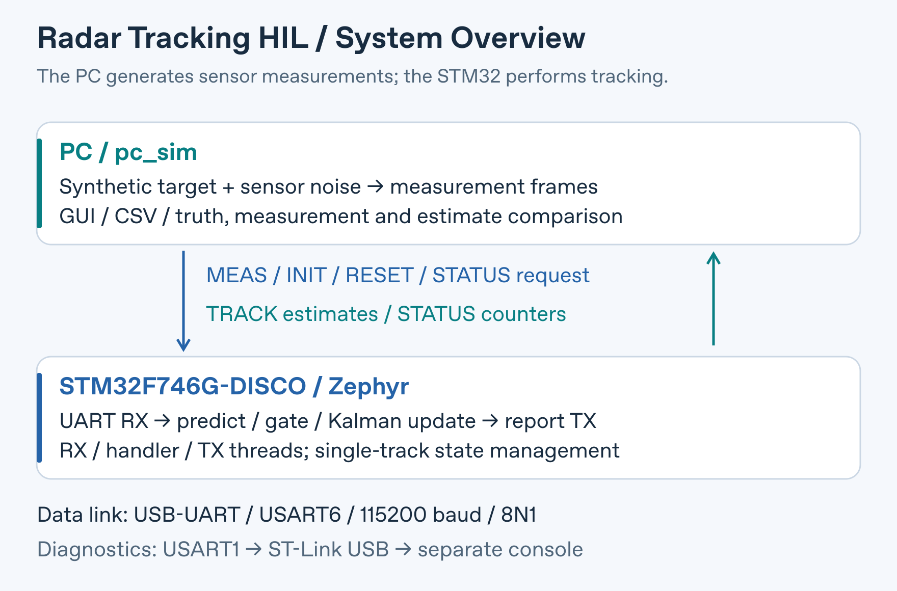
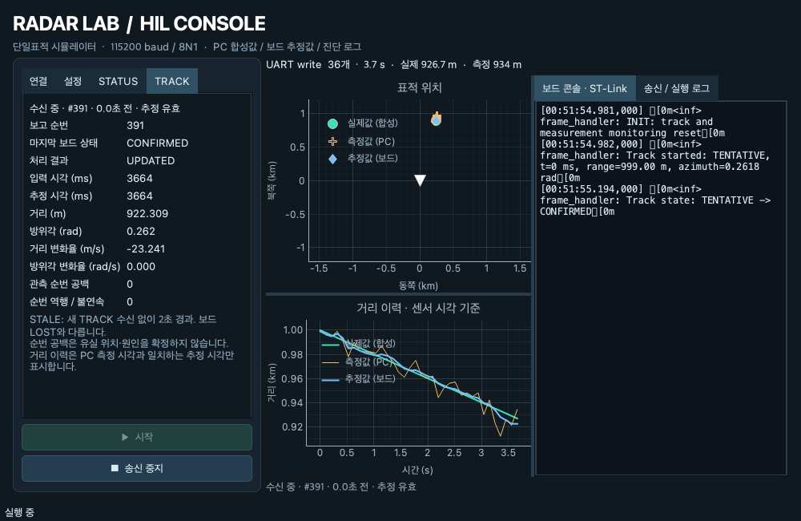

# radar-tracking-bench

<a id="radar-track-fcc-hil"></a>

**English** | [한국어](README.ko.md)

Previously named `radar-track-fcc-hil`.

**Single-target tracking HIL on STM32 and Zephyr — V1 complete (`v1.0.0`).**

A hardware-in-the-loop testbed for post-detection radar tracking. A PC sends synthetic range and azimuth measurements to an STM32, then compares the returned estimates with known ground truth. It provides a repeatable way to evaluate tracking accuracy, response latency, and recovery from corrupted frames, measurement outliers, and interrupted communication without a physical radar.

[Architecture](EXPLAINER.en.md) · [Board results](#board-results) · [Quick start](#quick-start) · [Scope](#scope-and-follow-up-work)

<a id="시스템-구성"></a>

## System overview



The firmware owns prediction, gating, Kalman updates, and track lifecycle management. Ground truth stays on the PC for evaluation; target IDs from the scenario are not sent to the board.

| Component | Implementation |
| --- | --- |
| Firmware | C, Zephyr RTOS, UART ISR and ring buffer, RX/handler/TX threads, bounded copying queues |
| Tracker | Independent range and azimuth constant-velocity Kalman filters, fixed gates, track acquisition/coasting/loss |
| Protocol and recovery | CRC-16, length validation, partial-frame and measurement timeouts, overflow recovery, stale-input rejection |
| PC tools | Python CLI and PySide6/pyqtgraph GUI, synthetic measurements, noise/outlier injection, TRACK/STATUS decoding, CSV recording and evaluation |

See the [architecture and ownership guide](EXPLAINER.en.md) for thread boundaries, queue behavior, and timing definitions.

<a id="gui-미리보기"></a>

## Physical-board example



Recorded during the November 18, 2026 board evaluation. The GUI compares PC ground truth and measurements with estimates decoded from the board's binary TRACK_REPORT. GUI labels are currently Korean. The separate no-board preview mode generates truth and measurements only; it does not simulate board estimates.

<a id="검증-결과"></a>

## Board results

V1 was completed on **November 19, 2026**. These are recorded observations from separate runs. Linked reports are in Korean and include configuration, source revisions, and raw CSV/JSON or console records.

| Test | Recorded result | Evidence |
| --- | --- | --- |
| 30-minute load | Target 50 Hz measurements + 1 Hz STATUS; actual 49.994 Hz. **89,990 measurements, all matched with responses** | [Load run](docs/hardware-test-2026-11-19-performance.md) |
| PC round-trip latency | **p99 8.049 ms; maximum 34.894 ms** in that load run | [Timing definitions](docs/performance-monitoring.md) |
| Board processing interval | RX frame completion to TX queue submission: observed maximum **1 ms**, zero over the 20 ms budget | [Load run](docs/hardware-test-2026-11-19-performance.md) |
| Noise sweep | **100 runs** across noise levels and seeds, with response-integrity checks and RMSE/gate-rejection measurements | [Noise and spike results](docs/hardware-test-2026-11-19-noise-spike.md) |
| Spike recovery | **49/49 cases passed**, covering single and five-consecutive range/angle spikes | [Noise and spike results](docs/hardware-test-2026-11-19-noise-spike.md) |
| Error recovery | CRC/partial frames, RX/TX wire disconnection, forced DRAIN ring overflow, and RX/TX queue saturation | [Verification history](docs/verification-history.md) |

The load run used a stationary target, zero noise, `perf.conf` with DRAIN recovery, and USART6 at 115200 baud/8N1. PC round-trip timing includes USB, UART, board processing, and host waiting. The board interval ends at TX queue submission, before UART transmission completes.

Current RTT budgets are p99 ≤20 ms and maximum ≤100 ms. The original load run failed its then-current host send-spacing criterion at 137.581 ms; that verdict is preserved separately from interpretation under the current RTT budgets. An earlier run's maximum RTT of 164.128 ms still exceeds the current budget. See [V1 acceptance and measurement limits](docs/roadmap.md#v1-acceptance).

For the noise sweep, each of 10 conditions used 10 seeds with firmware tuning fixed. At 8 m range-noise standard deviation, the mean of per-seed RMSE values fell from **8.2528 m to 3.0805 m**. This is an observed accuracy result, not a separate accuracy pass threshold. Across the 100 noise and 49 spike sessions, all **17,880 measurements** had matching responses. These sessions used 10 Hz synthetic sensor time and actual send rates of 9.260–9.626 Hz; they are separate from the 50 Hz load run.

<a id="시작하기"></a>

## Quick start

### Explore without a board

From the repository root, on a desktop with Python and a supported Qt environment:

```bash
python3 -m venv .venv
source .venv/bin/activate
python -m pip install -r pc_sim/requirements-gui.txt
python -m pc_sim.gui
```

In the connection tab (`연결`), keep preview mode (`미리보기`), click preview connect (`미리보기 연결`), then start (`시작`). No UART port is opened. [Detailed GUI guide — Korean](pc_sim/GUI.md).

To inspect the noise and spike plans without a board or output files:

```bash
python -m pc_sim.noise_sweep --dry-run
python -m pc_sim.spike_sweep --dry-run
```

### Run on STM32

Reference environment: **STM32F746G-DISCO, Zephyr 4.2, Zephyr SDK 0.17.2**. Use a configured Zephyr workspace and its Python environment for firmware builds.

The data link is **USART6, 115200 baud, 8N1, no flow control**:

| 3.3 V USB-UART adapter | STM32 connection |
| --- | --- |
| TXD | PC7 / USART6_RX |
| RXD | PC6 / USART6_TX |
| GND | GND |
| VCC / 5V / 3V3 | Leave unconnected; power the board and adapter through their own USB connections |

ST-Link USB is the separate flash/debug-console connection. Replace the repository path below with your checkout location:

```bash
source ~/zephyrproject/.venv/bin/activate
cd ~/zephyrproject
west build -d /path/to/radar-tracking-bench/build -b stm32f746g_disco /path/to/radar-tracking-bench/fcc_app
west flash -d /path/to/radar-tracking-bench/build --runner openocd
```

Return to the repository root and use the PC environment prepared above. Close the GUI and any other program using the data port before running the CLI. Replace `/dev/ttyUSB0` with the actual adapter port; macOS commonly uses `/dev/cu.usbserial...`.

```bash
python -m pc_sim.status_client --port /dev/ttyUSB0 --timeout 2
python -m pc_sim.evaluate run --port /dev/ttyUSB0 --scenario noisy
```

The evaluator sends measurements and collects board reports for CSV/RMSE evaluation. [Wiring and board setup — Korean](docs/board-bringup.md) · [CLI options and recording — Korean](pc_sim/README.md).

### Run host checks

From the repository root, using the PC environment above:

```bash
python -m pip install pytest
QT_QPA_PLATFORM=offscreen python -m pytest
```

Standalone C tests use CMake, Ninja, and a host C compiler. For example:

```bash
cmake -G Ninja -S fcc_app/tests/test_tracking -B /tmp/radar-track-tests -DTRACK_TEST_HOST=ON
cmake --build /tmp/radar-track-tests
ctest --test-dir /tmp/radar-track-tests --output-on-failure
```

Python and host C checks are separate from firmware builds and physical-board HIL runs. [Full test commands and coverage — Korean](docs/test-cases.md).

<a id="portfolio-v1"></a>
<a id="v1-acceptance"></a>
<a id="v1-범위"></a>

## Scope and follow-up work

V1 covers single-target measurement-to-result communication, quantitative tracking evaluation, major error recovery, and timing/resource observations. The [English architecture guide](EXPLAINER.en.md) explains the implemented contracts and their limits.

Multi-target association, CT/IMM/EKF comparisons, BIT/Lock On, and UART hardware-error diagnostics are follow-up work. RF processing, ADC/IQ/FFT, and operational certification are outside this project. [V1 scope and roadmap — Korean](docs/roadmap.md).

<a id="개발-방식"></a>

## Authorship

I defined the problem, architecture, and validation criteria, and wrote the STM32/Zephyr firmware. I used AI coding tools for the PC simulator, GUI, and test-support implementation. All measurements are synthetic; no operational military data or internal system information is used.

[English architecture](EXPLAINER.en.md) · [한국어 README](README.ko.md) · [Full documentation index — Korean](docs/README.md)
