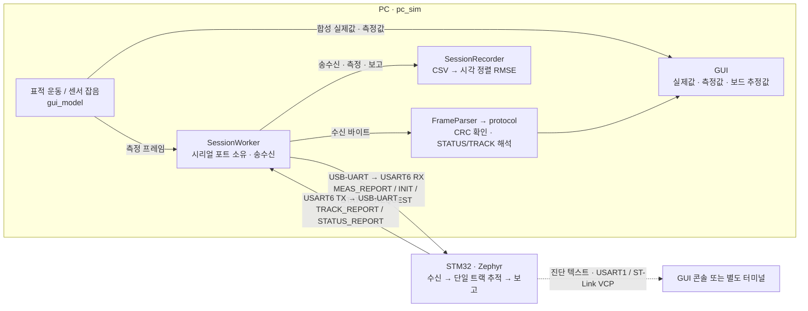
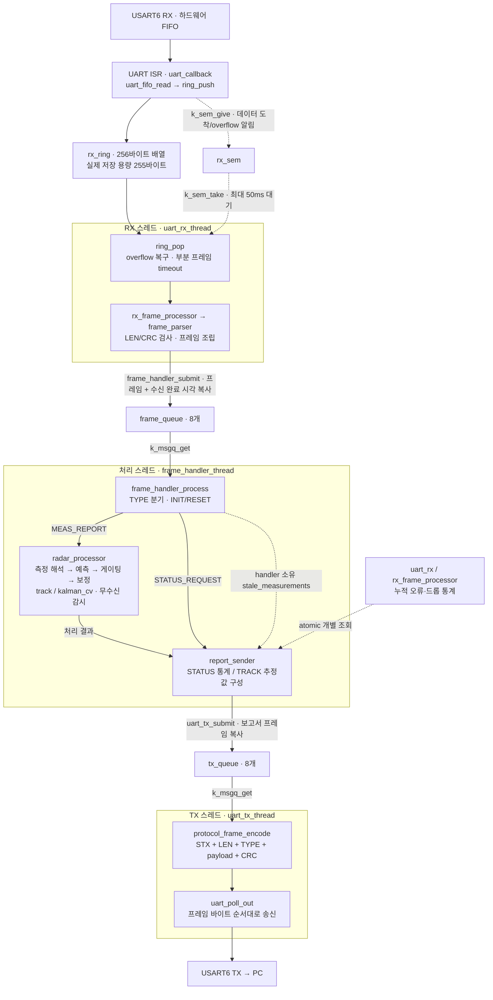

# radar-track-fcc-hil

STM32 + Zephyr RTOS 기반 레이더 추적 학습 프로젝트입니다. 현재 펌웨어는 단일 트랙 처리와 UART 측정 수신·결과 송신을 구현했으며, PC 시뮬레이터로 보드 시험을 진행합니다.
PC가 합성 표적·측정값을 생성하고 STM32가 추적 결과를 반환해 RMSE와 트랙 연속성 같은 지표로 검증하는 구조를 목표로 합니다.

> **개발 방식**  
> 문제 정의, 요구사항, 시스템 구조와 검증 기준을 직접 설계하고, STM32/Zephyr 펌웨어는 직접 작성하며 학습하고 있습니다. PC 시뮬레이터와 GUI 구현에는 AI 코딩 에이전트를 활용하며, 결과를 검토하고 실제 보드와 연결해 검증합니다. 이 저장소는 합성 측정 데이터를 사용하는 실험용 HIL 시스템이며 실제 군 운용 데이터나 내부 시스템 정보를 사용하지 않습니다.

## 입출력과 시스템 연결

PC는 측정 입력을 만들고, STM32는 추적 계산을 수행해 결과를 반환합니다.
아래는 GUI 보드 모드의 현재 연결입니다. 합성 실제값은 비교 기준으로 PC에만 남습니다.



데이터와 진단 콘솔은 별도 포트입니다. GUI와 CLI가 같은 포트를 동시에 열지 않습니다.
CLI 송신기(`radar_sender`, `run_sim`)는 측정 송신만 수행합니다. GUI와 `python -m pc_sim.evaluate`는 TRACK 수집·CSV 저장을 지원합니다.

## 펌웨어 내부 처리 흐름

실선은 데이터 전달, 점선은 알림·진단 통계 조회를 나타냅니다. ISR은 바이트를 저장하고 RX 스레드를 깨우며,
파싱·추적 계산·보고서 구성은 스레드 문맥에서 수행합니다.



트랙과 보고 순번은 처리 스레드가 소유합니다. 큐는 구조체를 복사하고, 세마포어는 바이트를 전달하지 않습니다.
RX/handler는 입력이 없어도 주기적으로 깨어 timeout을 확인합니다. TX는 현재 polling 방식이며 TX ISR/DMA를 사용하지 않습니다.
큐 접수·UART write 성공은 상대 수신 ACK가 아닙니다. INIT/RESET·무수신 timeout은 무효 TRACK 초기화 보고를 한 번 제출합니다. 기본 실보드 왕복을 확인했습니다.

## 시스템 역할

**PC는 추적 전 레이더 탐지 측정 출력을 모사하고, STM32는 그 측정으로 표적을 추적하는 컴퓨터입니다.**
이미 추적을 끝내고 안정적인 target ID를 제공하는 레이더 장비를 입력으로 가정하지 않습니다.

- `pc_sim`: 합성 표적에서 시간·거리·방위각 측정을 생성합니다. 실제 RF 신호처리를 구현하지 않습니다.
- 펌웨어: 예측·게이팅·칼만 필터·트랙 상태 관리를 담당합니다.
  다중표적 확장 시 측정-트랙 연관과 `track_id` 부여도 펌웨어에서 구현합니다.
- GUI: 시험 제어와 PC 합성값·보드 추정값 비교, STATUS 통계·진단 로그 표시를 담당합니다.
- PC의 정답 `target_id`는 내부 시뮬레이션·향후 평가용이며 측정 payload로 보내지 않습니다.

현재는 단일 트랙입니다. **측정 경로의 TRACK_REPORT 송신은 펌웨어에 구현됐고 host 검증을 마쳤습니다.** PC TRACK 디코더·GUI 비교 그래프도 구현하고 모사 UART로 검증했습니다. CSV 기록과 고정 시나리오 실보드 RMSE 평가도 구현·검증했습니다. 보드 지연·자원 관측을 확보했으며 장시간 부하의 전체 기준 충족은 재시험이 필요합니다. 다중표적 연관·트랙 ID 관리는 미구현입니다.
역할 경계와 ID 정책은 [시스템 역할 문서](docs/system-roles.md)를 기준으로 합니다.

2026-11-15 계획 조정: **단일표적 결과 반환·오차 비교·시간/자원 측정·오류 복구까지 확인한 v1**을 먼저 완성합니다. 다중표적은 v2 후보이며 현재 구현 여부와 별개입니다. [v1 검증 및 완료 기준](#v1-acceptance)을 완료 범위의 기준으로 사용합니다.

## 개발 환경

| 항목           | 값                           |
| -------------- | ---------------------------- |
| 보드           | STM32F746G-DISCO (Cortex-M7) |
| RTOS           | Zephyr v4.2                  |
| SDK            | `~/zephyr-sdk-0.17.2`         |
| west workspace | `~/zephyrproject`            |

개인 `.vscode/` 설정은 추적하지 않습니다. [VS Code 사용 안내](tools/vscode/README.md)는
컴파일 데이터베이스 연결 방법을 설명하며, 빌드·테스트는 에디터 없이도 실행할 수 있습니다.

## PC 도구

측정 송신기·시나리오·STATUS CLI는 `pc_sim/`에 있습니다. [실행 방법과 옵션](pc_sim/README.md)을 참고하세요.

```bash
source ~/zephyrproject/.venv/bin/activate

# 저장소 루트, 보드 없이 현재 프레임 출력
python pc_sim/radar_sender.py --count 3 --noise 0
python -m pc_sim.run_sim --duration 1 --noise 0 --azimuth-noise 0

# 실제 UART: 포트는 자신의 어댑터 이름으로 변경
python pc_sim/radar_sender.py --port /dev/cu.usbserial-A5069RR4 --count 20 --noise 0

# 자동 테스트: 보드 연결·flash 없음
python -m pytest
```

두 연속 송신기는 실행마다 INIT을 한 번 자동 전송한 뒤 timestamp를 0부터 시작합니다. `run_sim.py --port ...`로 시나리오를 보드에 보낼 수도 있습니다.
다중표적·클러터 시나리오는 현재 단일 트랙 펌웨어의 제약 때문에 PC 출력 모드에서만 허용합니다.

전체 Python·C 테스트의 케이스와 검증 범위는 [테스트 케이스 목록](docs/test-cases.md)에 정리했습니다.
요구사항별 규격·구현·테스트·검증 공백은 [요구사항 추적표](docs/requirements-traceability.md)에서 확인합니다.
STATUS 요청·응답 CLI: `python -m pc_sim.status_client --port PORT --timeout 2` — [사용법](pc_sim/README.md#status-진단-요청).

## 데스크톱 GUI

```sh
source ~/zephyrproject/.venv/bin/activate
python -m pip install -r pc_sim/requirements-gui.txt
python -m pc_sim.gui
```

미리보기·실제 UART 송신, 실시간 표적/거리 그래프, ST-Link 콘솔을 지원합니다.
[GUI 실행 안내](pc_sim/GUI.md)를 참고하세요. 초록색은 합성 실제값, 노란색은 PC 측정값, 파란색은 수신한 보드 추정값입니다. 미리보기에는 보드 추정값이 없습니다. 아래 이미지는 이전 미리보기 화면입니다.


## UART 복구 C 테스트 (보드 불필요)

```bash
cmake -G Ninja -S fcc_app/tests/test_uart_rx -B /tmp/radar-uart-tests
cmake --build /tmp/radar-uart-tests
ctest --test-dir /tmp/radar-uart-tests --output-on-failure
```

실제 수신·복구 코드와 모사 UART를 사용하는 host 테스트입니다.
실행 조건과 검증 한계는 [UART 테스트 안내](fcc_app/tests/test_uart_rx/README.md)를 참고하세요.
Python 테스트와 별도이며 실제 보드 HIL을 대신하지 않습니다.
필터·추적 정책은 [Tracking C 테스트](fcc_app/tests/test_tracking/README.md)로 별도 검증합니다.

TX host 테스트는 [TX 테스트 안내](fcc_app/tests/test_uart_tx/README.md)를 참고하세요.

STATUS·TRACK 보고와 명령·측정 처리 테스트는 [handler 테스트 안내](fcc_app/tests/test_frame_handler/README.md)를 참고하세요.

성능 계측은 별도 `perf.conf`로 켭니다. [계측 범위·빌드·보드 시험 절차](docs/performance-monitoring.md), [계측 host 테스트](fcc_app/tests/test_perf_monitor/README.md)를 참고하세요.

## 펌웨어 빌드·플래시

```bash
cd ~/zephyrproject
west build -d /path/to/radar-track-fcc-hil/build -b stm32f746g_disco /path/to/radar-track-fcc-hil/fcc_app -- -DCMAKE_EXPORT_COMPILE_COMMANDS=ON
west flash -d /path/to/radar-track-fcc-hil/build --runner openocd
```

콘솔은 ST-Link VCP에서 확인합니다. Linux 예: `tio /dev/ttyACM0`.
보드 시험 절차는 [board-bringup.md](docs/board-bringup.md)를 참고하세요.

## 현재 UART 규격

```text
7E | LEN(1) | TYPE(1) | PAYLOAD(LEN) | CRC_H(1) | CRC_L(1)
```

- LEN은 payload 길이이며 1..32바이트. CRC는 LEN·TYPE·payload를 포함하며 상위 바이트부터 전송합니다.
- 측정 payload는 big-endian `>IHi`: timestamp_ms(uint32), range_m(uint16), azimuth_sc(int32), 총 10바이트.
- 방위각은 semicircle: `rad = azimuth_sc × π / 2³¹`. 보드 내부 추정은 라디안입니다.
- TYPE: INIT=1, MEAS_REPORT=2, STATUS_REQUEST=3, COMMAND=4, RESET=5, STATUS_REPORT=6, TRACK_REPORT=7.
- INIT/RESET은 트랙을 초기화합니다. STATUS는 누적 통계를 이진 응답으로 반환하며 DEBUG 로그에는 큐 접수만 기록합니다. COMMAND는 미구현이라 무시 이유를 경고합니다.
  STATUS 통계는 32바이트 STATUS_REPORT(여덟 uint32)로 TX 큐에 제출합니다. PC는 구형 16/28바이트 응답도 읽으며 없는 필드는 미지원으로 표시합니다.
- TRACK_REPORT는 32바이트 payload(전체 37바이트)로 순번·입력/추정 시각·거리/방위각·변화율·상태/결과·유효 플래그를 반환합니다. 신선한 유효 측정 payload마다 한 번 제출하며 게이트/시각 거부도 보고합니다. PC 디코더·GUI는 구현했으며 INIT/RESET·무수신 timeout 이벤트 보고도 구현했습니다(기본 실보드 검증 완료). [필드와 동작 규격](docs/requirements-traceability.md#spec-track-report).

## RX 버퍼와 overflow 복구

`fcc_app/src/common/ring_buffer.h`의 `RING_BUFFER_SIZE`는 **256바이트**, 실제 저장 용량은 **255바이트**입니다.
빈 상태와 가득 찬 상태를 구분하기 위해 한 칸을 비웁니다. `uint8_t` 인덱스는 0..255를
표현하므로 현재 크기에 맞지만, 256보다 크게 늘릴 때는 인덱스 타입도 변경해야 합니다.

현재 `prj.conf`에서 `CONFIG_RADAR_RX_OVERFLOW_DRAIN=y`를 선택하며, `uart_rx.c`에서 이를 `RX_OVERFLOW_POLICY_DRAIN_BUFFER`로 매핑합니다.
정책은 `fcc_app/Kconfig`의 choice로 정의하고 `prj.conf`에서 선택합니다.
버퍼가 가득 차면 실패한 바이트를 버리고 overflow 플래그를 설정합니다. 복구 중 새 입력도
버리며, 기존 파서 상태와 저장된 바이트로 완성할 수 있는 프레임만 처리한 뒤 나머지를 초기화합니다.
`RX_OVERFLOW_POLICY_DISCARD_ALL`은 저장된 바이트와 부분 프레임을 모두 바로 폐기합니다.
두 정책 모두 무손실 수신을 보장하지 않습니다. 실제 overflow 빈도·복구 타이밍은 보드 시험 대상입니다.

CRC 규격은 **CRC-16/IBM-3740 (CCITT-FALSE)**입니다. poly=`0x1021`, init=`0xFFFF`,
refin/refout=false, xorout=`0x0000`이며 `123456789`의 기준값은 `0x29B1`입니다.
규격 이름과 매개변수는 [Zephyr CRC 문서](https://docs.zephyrproject.org/latest/doxygen/html/group__crc.html)와 일치합니다.
STX와 CRC 자체는 계산에서 제외합니다. 측정 프레임은 총 15바이트, INIT은 6바이트입니다.
프로토콜 변경 시 Python 송신기·GUI와 보드 펌웨어를 함께 갱신해야 합니다.

정상 프레임은 깊이 8의 큐에 복사합니다. 큐가 가득 차면 새 프레임을 버리고 누적 드롭을 집계합니다.
INIT/RESET도 큐 포화 시 드롭될 수 있습니다.

## 파일 구조

```text
fcc_app/src/
    main.c            초기화·진입점
    transport/        uart_rx, uart_tx, rx_frame_processor
    protocol/         frame_parser, protocol_frame, measurement_message, status_message, track_message
    application/      frame_handler(큐·분기), radar_processor(추적), report_sender(보고서 구성·제출)
    tracking/         track, kalman_cv, gating, angle_utils
    common/           crc16, ring_buffer, math_constants, byte_order
    diagnostics/      선택적 perf_monitor(집계), perf_reporter(요약·스택 조회)
fcc_app/tests/
    test_uart_rx/      UART drain·링버퍼·부분 프레임 timeout
    test_frame_handler/ STATUS·TRACK·INIT/RESET·측정 timeout·processor 계약
    test_uart_tx/      TX 큐·인코딩·송신 순서
    test_perf_monitor/ 시간·큐 통계, 동시 snapshot, 요약·스택 조회 모사
    test_tracking/       필터·게이팅·추적 C 회귀 테스트
    log_stress/        별도 로그 부하 시험 도구(대상 버전 확인 필요)
tools/vscode/         선택적 VS Code 개발 환경 안내
pc_sim/
    gui.py             데스크톱 화면·실시간 그래프
    gui_worker.py      시리얼 소유·송수신·콘솔 작업 스레드
    frame_parser.py    PC 수신 프레임 조립·CRC 검증
    status_client.py   STATUS 요청·응답 CLI
    recording.py       세션 CSV 저장·시각 정렬 RMSE
    evaluate.py        정상·잡음·연속 누락 보드 평가 CLI
    gui_model.py       설정·측정 생성·TRACK 이력/수신 신선도
    protocol.py        공통 프레임 생성·단위 변환·STATUS/TRACK 해석
    radar_sender.py    간단한 거리 변화 측정 송신
    frame_sender.py 단일 프레임 송신·수동 INIT
    targets.py         표적·센서 모델
    run_sim.py         시나리오 출력·UART 송신
    README.md          실행·옵션·제약
tests/                Python 프로토콜·송신기·시나리오 테스트
```

## 구현 범위

| 영역 | 구현된 기능 | 미구현·제한 |
| --- | --- | --- |
| 수신·프로토콜 | UART ISR, 링버퍼, CRC-16·길이 검사, 수신 모듈 분리·부분 프레임 timeout | 스캔 단위 다중 측정 규격 |
| 실행 구조 | RX → 복사 큐 → handler → TX 복사 큐 → TX 스레드, RX 큐 포화 시 드롭 집계 | 전체 동시성·장시간 부하 판정 |
| 단일표적 추적 | 거리·방위각 CV 칼만 필터, 게이팅, 트랙 상태·무수신 timeout | 다중 측정 연관, 트랙 테이블·자체 track_id·표적별 수명 관리 |
| 결과 보고 | 측정 처리별 32바이트 TRACK_REPORT 인코딩·TX 제출, 순번·유효성, host 30개 회귀·기본 실보드 왕복 | 이벤트 원인별 구분, 장시간 부하 판정 |
| 제어·상태 | INIT/RESET 초기화, STATUS로 RX 누적 통계 조회·로그·TX 제출, PC CLI 수신 | BIT·Lock On 미구현; 추가 장애 시험 |
| 오류 복구 | drain/discard 정책, CRC·길이 오류 프레임 제외 | DRAIN 강제 overflow 복귀 확인; 프레임 경계 행렬·UART overrun 미검증 |
| PC 시뮬레이터 | 측정·잡음 생성, PC 출력용 다중표적·미탐지·클러터 시나리오 | 실제 UART 모드는 단일표적·클러터 0으로 제한 |
| GUI·평가 | 송신 제어, 합성 실제값·측정값·보드 추정값 그래프, STATUS/TRACK·STALE 표시, 콘솔·CSV 저장·고정 시나리오 RMSE | 다중표적 GUI, 각도 기동·잡음 평가 및 장시간 연속성 |

실제 RF 송수신·ADC/IQ·FFT 신호처리와 완성된 레이더 운용 시스템은 프로젝트 범위 밖입니다.
EKF, Mahalanobis 게이팅, LCD 표시는 현재 미구현이며 우선 TODO에는 포함하지 않습니다.

## 개발 현황과 TODO

완료 기능과 남은 작업의 상세 목록은 [개발 로드맵](docs/roadmap.md)에 모았습니다.

<a id="portfolio-v1"></a>
<a id="v1-acceptance"></a>

**현재 목표는 단일표적 v1 완료입니다.** 결과 왕복·고정 시나리오 RMSE 평가·주요 오류 복구를 확인했으며, 지속 부하 재시험·최종 오류 회귀·재현 자료 정리가 남았습니다. 다중표적·BIT·Lock On은 후속 범위입니다. [V1-1~5 완료 기준과 판정 조건](docs/roadmap.md#v1-acceptance)을 따릅니다.

## 다음 구현 순서

1. PC 진행 집계 수정 후 **50Hz·STATUS 1Hz·30분 실보드 재시험**. 호스트 송신 간격 100ms 이하·보드 RX→TX 제출 20ms 이하 기준을 유지합니다.
2. 최종 구성의 오류 복구 회귀를 확인합니다.
3. 재현 명령·원시 기록·그래프·짧은 시연을 정리하고 v1 완료 여부를 판정합니다.

## 검증 현황

단일표적 왕복·GUI/CSV·고정 시나리오 평가와 주요 오류 복구를 실보드에서 확인했습니다. Python/host 테스트, 빌드, 실보드 시험은 각각의 기록 범위로 구분합니다.

기존 [30분 시험](docs/hardware-test-2026-11-18-performance.md)은 보드 지연 최대1ms·오류0이었지만 **호스트 송신 간격 기준 미달로 전체 실패**입니다. [추가 진단](docs/test-results/tx-timing-probe-2026-11-18/README.md)에서 PC 진행 집계 비용을 확인해 수정했으며, 수정 후 장시간 판정은 재시험으로 확인합니다. 상세 결과·대상 버전·한계는 [검증 이력](docs/verification-history.md)을 참고하세요.

## HIL 통신 구조 · 배선

PC에 USB 2개로 콘솔과 데이터 링크를 분리한다. 서로 간섭 없이 디버깅하기 위함.

- **채널 A (콘솔·플래시):** DISCO 내장 ST-Link VCP → `/dev/ttyACM0`.
- **채널 B (HIL 데이터):** STM32 USART6 → 외부 USB-UART 어댑터 → `/dev/ttyUSB0`.

> macOS 포트 이름은 다름: 어댑터 `/dev/tty.usbserial-XXXX`, ST-Link `/dev/tty.usbmodemXXXX`.

### 핀 배선

| USB-UART 어댑터 | ↔    | STM32 DISCO 핀 | STM32 기능 |
| --------------- | :--: | -------------- | ---------- |
| GND             | ──   | GND            | 공통 접지 |
| TXD (3.3V out)  | ──→  | PC7       | USART6_RX |
| RXD (3.3V in)   | ←──  | PC6      | USART6_TX |
| VCC / 5V / 3V3  | ✗    | 연결 안 함     | 각자 USB 자가 전원 |

- TX↔RX 크로스 연결.
- GND 공통 연결.
- 보드와 어댑터가 각각 USB로 급전되는 구성에서는 전원선 연결하지 않음.

현재 설정 기준 배선·검증 절차는 [docs/board-bringup.md](docs/board-bringup.md)를 참고합니다.


## 주요 설정

애플리케이션 설정은 `fcc_app/Kconfig`에서 정의하고 `fcc_app/prj.conf`에서 선택합니다.
변경 후 펌웨어를 다시 빌드합니다.

| 설정 | 기본값 | 의미 |
|---|---|---|
| `CONFIG_RADAR_RX_OVERFLOW_DRAIN` | `y` | 저장된 바이트로 완성 가능한 프레임을 처리한 뒤 복구 |
| `CONFIG_RADAR_FRAME_RX_TIMEOUT_MS` | `1000` | 부분 프레임 바이트 처리 중단 제한(ms) |
| `CONFIG_RADAR_MEASUREMENT_TIMEOUT_MS` | `1000` | 첫 정상 측정 이후 무수신 제한 및 큐 측정 최대 허용 나이(ms, 경계 폐기) |
| `CONFIG_RADAR_RANGE_GATE_M` | `100` | 거리 오차 상한(m) |
| `CONFIG_RADAR_AZIMUTH_GATE_DEG` | `10` | 각도 오차 상한(정수 degree) |

게이트 설정 예:

```ini
CONFIG_RADAR_RANGE_GATE_M=100
CONFIG_RADAR_AZIMUTH_GATE_DEG=10
```

값은 전체 창 폭이 아닌 **허용 오차의 절댓값 상한**입니다. 기본값은 ±100 m·±10°이며,
두 조건을 모두 만족해야 통과합니다. 경계도 포함합니다. 거리 설정은 1–65535 m,
각도 설정은 정수 1–180°를 허용하고 내부 계산은 radian입니다.
180°는 정규화된 각도 오차를 모두 허용하지만 거리 검사는 유지합니다.
공분산 기반 적응형 게이트는 아닙니다. π는 `common/math_constants.h`의 수학 상수입니다.

[설정별 테스트](fcc_app/tests/test_tracking/README.md) · [전체 펌웨어 주석 점검](docs/comment-audit.md).

## 상세 문서

- [개발 로드맵·TODO·v1 완료 기준](docs/roadmap.md)
- [시스템 역할·ID 정책](docs/system-roles.md) · [구현 흐름](EXPLAINER.md)
- [PC CLI](pc_sim/README.md) · [GUI](pc_sim/GUI.md) · [배선·보드 시험](docs/board-bringup.md)
- [요구사항 추적표](docs/requirements-traceability.md) · [테스트 목록](docs/test-cases.md) · [검증 기록](docs/verification-history.md)
- [코딩 스탠다드](docs/coding-standard.md) · [코드 점검](docs/coding-standard-audit.md) · [주석 점검](docs/comment-audit.md) · [구조·이름 점검](docs/naming-review.md)

STATUS 규격은 수동 관리합니다. C의 `status_report`·인코더와 Python의
`STATUS_FIELDS`를 함께 변경하면 CLI·GUI 표시가 필드 목록을 따라갑니다.
코드 생성 스크립트나 별도 생성 단계는 없습니다. [필드 규격·호환성](pc_sim/README.md#status_report-payload).
