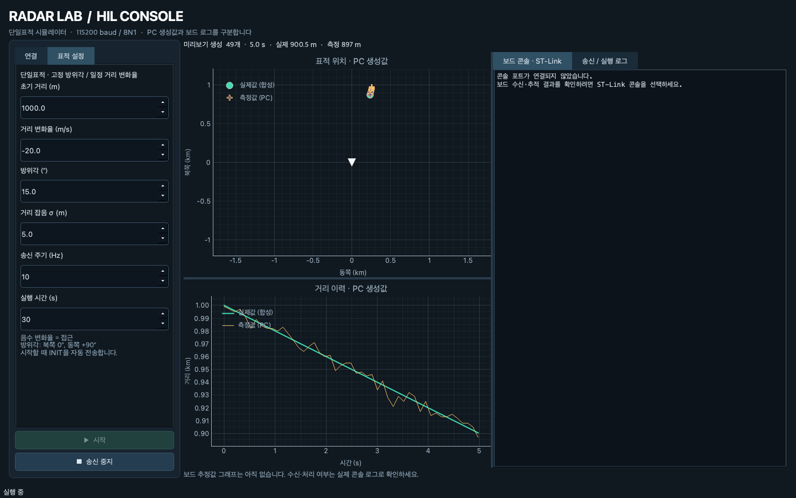

# radar-track-fcc-hil

STM32 + Zephyr RTOS 기반 레이더 추적 학습 프로젝트입니다. 현재 구현은 단일 트랙과 UART 측정 수신이며, PC 시뮬레이터로 보드 시험을 진행합니다.
PC가 합성 표적·측정값을 생성하고 STM32가 추적 결과를 반환해 RMSE와 트랙 연속성 같은 지표로 검증하는 구조를 목표로 합니다.

> **개발 방식**  
> 문제 정의, 요구사항, 시스템 구조와 검증 기준을 직접 설계하고, STM32/Zephyr 펌웨어는 직접 작성하며 학습하고 있습니다. PC 시뮬레이터와 GUI 구현에는 AI 코딩 에이전트를 활용하며, 결과를 검토하고 실제 보드와 연결해 검증합니다. 이 저장소는 개인 학습·포트폴리오용 합성 시뮬레이션이며 실제 군 운용 데이터나 내부 시스템 정보를 사용하지 않습니다.

```text
pc_sim (Python 측정 생성)
  → CRC-16 프레임 / USB-UART
  → STM32 RX: uart_rx → rx_frame_processor → frame_parser
  → 메시지 큐 → frame_handler 스레드 → track / Kalman
  → ST-Link 콘솔에서 결과 확인
```

## 시스템 역할

**PC는 추적 전 레이더 탐지 측정 출력을 모사하고, STM32는 그 측정으로 표적을 추적하는 컴퓨터입니다.**
이미 추적을 끝내고 안정적인 target ID를 제공하는 레이더 장비를 입력으로 가정하지 않습니다.

- `pc_sim`: 합성 표적에서 시간·거리·방위각 측정을 생성합니다. 실제 RF 신호처리를 구현하지 않습니다.
- 펌웨어: 예측·게이팅·칼만 필터·트랙 상태 관리를 담당합니다.
  다중표적 확장 시 측정-트랙 연관과 `track_id` 부여도 펌웨어에서 구현합니다.
- GUI: 시험 제어와 PC 합성값·보드 로그 표시를 담당합니다.
- PC의 정답 `target_id`는 내부 시뮬레이션·향후 평가용이며 측정 payload로 보내지 않습니다.

현재는 단일 트랙이며 **다중표적 연관·트랙 ID 관리·보드 추정 결과 반환은 미구현**입니다.
역할 경계와 ID 정책은 [시스템 역할 문서](docs/system-roles.md)를 기준으로 합니다.

## 개발 환경

| 항목           | 값                           |
| -------------- | ---------------------------- |
| 보드           | STM32F746G-DISCO (Cortex-M7) |
| RTOS           | Zephyr v4.2                  |
| SDK            | `~/zephyr-sdk-0.17.2`         |
| west workspace | `~/zephyrproject`            |

## PC 도구: `pc_sim/` 하나로 통합

[실행 방법과 옵션](pc_sim/README.md). 기존 `tools/hil/` 도구를 `pc_sim/`으로 옮기고,
기존 시나리오 실행기도 현재 펌웨어 규격으로 변경했습니다. 현재 프로토콜은 CRC-16/IBM-3740이며 이전 XOR 규격과 호환되지 않습니다.

```bash
source ~/zephyrproject/.venv/bin/activate

# 저장소 루트, 보드 없이 현재 프레임 출력
python pc_sim/radar_sender.py --count 3 --noise 0
python -m pc_sim.run_sim --duration 1 --noise 0 --azimuth-noise 0

# 실제 UART: 포트는 자신의 어댑터 이름으로 변경
python pc_sim/radar_sender.py --port /dev/cu.usbserial-A5069RR4 --count 20 --noise 0

# 자동 테스트: 보드 연결·flash 없음
python -m pytest
```

두 연속 송신기는 실행마다 INIT을 한 번 자동 전송한 뒤 timestamp를 0부터 시작합니다. `run_sim.py --port ...`로 시나리오를 보드에 보낼 수도 있습니다.
다중표적·클러터 시나리오는 현재 단일 트랙 펌웨어의 제약 때문에 PC 출력 모드에서만 허용합니다.

전체 Python·C 테스트의 케이스와 검증 범위는 [테스트 케이스 목록](docs/test-cases.md)에 정리했습니다.
요구사항별 규격·구현·테스트·검증 공백은 [요구사항 추적표](docs/requirements-traceability.md)에서 확인합니다.
STATUS 요청·응답 CLI: `python -m pc_sim.status_client --port PORT --timeout 2` — [사용법](pc_sim/README.md#status-진단-요청). 모사 테스트 완료, 실제 보드 왕복은 미검증입니다.

## 데스크톱 GUI

```sh
source ~/zephyrproject/.venv/bin/activate
python -m pip install -r pc_sim/requirements-gui.txt
python -m pc_sim.gui
```

미리보기·실제 UART 송신, 실시간 표적/거리 그래프, ST-Link 콘솔을 지원합니다.
[GUI 실행 안내](pc_sim/GUI.md)를 참고하세요. 그래프는 PC 생성값이며 보드 추정 결과가 아닙니다.



## UART 복구 C 테스트 (보드 불필요)

```bash
cmake -G Ninja -S fcc_app/tests/test_uart_rx -B /tmp/radar-uart-tests
cmake --build /tmp/radar-uart-tests
ctest --test-dir /tmp/radar-uart-tests --output-on-failure
```

실제 수신·복구 코드와 모사 UART를 사용하는 20개 테스트입니다.
실행 조건과 검증 한계는 [UART 테스트 안내](fcc_app/tests/test_uart_rx/README.md)를 참고하세요.
Python 테스트와 별도이며 실제 보드 HIL을 대신하지 않습니다.
필터·추적 정책은 [Tracking C 테스트](fcc_app/tests/test_kalman/README.md)로 별도 검증합니다.

TX host 테스트 4개는 [TX 테스트 안내](fcc_app/tests/test_uart_tx/README.md)를 참고하세요.

STATUS 처리 테스트 5개는 [STATUS 테스트 안내](fcc_app/tests/test_frame_handler/README.md)를 참고하세요.

## 펌웨어 빌드·플래시

```bash
cd ~/zephyrproject
west build -d /path/to/radar-track-fcc-hil/build -b stm32f746g_disco /path/to/radar-track-fcc-hil/fcc_app -- -DCMAKE_EXPORT_COMPILE_COMMANDS=ON
west flash -d /path/to/radar-track-fcc-hil/build --runner openocd
```

콘솔은 ST-Link VCP에서 확인합니다. Linux 예: `tio /dev/ttyACM0`.
보드 시험 절차는 [board-bringup.md](docs/board-bringup.md)를 참고하세요.

## 현재 UART 규격

```text
7E | LEN(1) | TYPE(1) | PAYLOAD(LEN) | CRC_H(1) | CRC_L(1)
```

- LEN은 payload 길이이며 1..32바이트. CRC는 LEN·TYPE·payload를 포함하며 상위 바이트부터 전송합니다.
- 측정 payload는 big-endian `>IHi`: timestamp_ms(uint32), range_m(uint16), azimuth_sc(int32), 총 10바이트.
- 방위각은 semicircle: `rad = azimuth_sc × π / 2³¹`. 보드 내부 추정은 라디안입니다.
- TYPE: INIT=1, RADAR_MEAS=2, STATUS=3, COMMAND=4, RESET=5.
- INIT/RESET은 트랙을 초기화합니다. STATUS는 RX 오류·timeout·queue drop 누적 통계를 로그로 출력합니다. COMMAND는 타입 로그만 출력합니다.
  STATUS 통계는 16바이트 STATUS_REPORT로 TX 큐에 제출합니다. PC CLI 수신은 구현했으며 GUI 표시와 실보드 응답 검증은 남아 있습니다.
- 현재 보드는 UART로 이진 트랙 결과를 반환하지 않습니다.

## RX 버퍼와 overflow 복구

`fcc_app/src/common/ring_buffer.h`의 `RING_BUFFER_SIZE`는 **256바이트**, 실제 저장 용량은 **255바이트**입니다.
빈 상태와 가득 찬 상태를 구분하기 위해 한 칸을 비웁니다. `uint8_t` 인덱스는 0..255를
표현하므로 현재 크기에 맞지만, 256보다 크게 늘릴 때는 인덱스 타입도 변경해야 합니다.

현재 `uart_rx.h`의 `RX_OVERFLOW_POLICY`는 `RX_OVERFLOW_POLICY_DRAIN_BUFFER`입니다.
이는 헤더에서 선택하는 빌드 시점 설정이며 Kconfig 옵션은 아직 없습니다.
버퍼가 가득 차면 실패한 바이트를 버리고 overflow 플래그를 설정합니다. 복구 중 새 입력도
버리며, 기존 파서 상태와 저장된 바이트로 완성할 수 있는 프레임만 처리한 뒤 나머지를 초기화합니다.
`RX_OVERFLOW_POLICY_DISCARD_ALL`은 저장된 바이트와 부분 프레임을 모두 바로 폐기합니다.
두 정책 모두 무손실 수신을 보장하지 않습니다. 실제 overflow 빈도·복구 타이밍은 보드 시험 대상입니다.

CRC 규격은 **CRC-16/IBM-3740 (CCITT-FALSE)**입니다. poly=`0x1021`, init=`0xFFFF`,
refin/refout=false, xorout=`0x0000`이며 `123456789`의 기준값은 `0x29B1`입니다.
규격 이름과 매개변수는 [Zephyr CRC 문서](https://docs.zephyrproject.org/latest/doxygen/html/group__crc.html)와 일치합니다.
STX와 CRC 자체는 계산에서 제외합니다. 측정 프레임은 총 15바이트, INIT은 6바이트입니다.
Python 송신기·GUI와 보드 펌웨어를 함께 갱신해야 합니다. 최신 실보드·GUI 시험 결과는 [검증 기록](docs/hardware-test-2026-11-01.md)을 참고하세요.

정상 프레임은 깊이 8의 큐에 복사합니다. 큐가 가득 차면 새 프레임을 버리고 누적 드롭을 집계합니다.
INIT/RESET도 큐 포화 시 드롭될 수 있습니다.

## 파일 구조

```text
fcc_app/src/
    main.c            초기화·진입점
    transport/        uart_rx, uart_tx, rx_frame_processor
    protocol/         frame_parser, protocol_frame, radar_message
    application/      frame_handler: 메시지 처리·추적 실행
    tracking/         track, kalman_cv, gating, angle_utils
    common/           crc16, ring_buffer
fcc_app/tests/
    test_uart_rx/      UART drain·링버퍼·부분 프레임 timeout
    test_frame_handler/ STATUS 통계·추적 상태 보존
    test_uart_tx/      TX 큐·인코딩·송신 순서
    test_kalman/       필터·게이팅·추적 C 회귀 테스트
tools/vscode/         로컬 VS Code 설정 예제
pc_sim/
    gui.py             데스크톱 화면·실시간 그래프
    gui_worker.py      시리얼 소유·송신·콘솔 작업 스레드
    gui_model.py       GUI 설정·단일표적 측정 생성
    protocol.py        유일한 프레임 생성·단위 변환
    radar_sender.py    간단한 거리 변화 측정 송신
    small_byte_test.py 단일 프레임 송신·수동 INIT
    targets.py         표적·센서 모델
    run_sim.py         시나리오 출력·UART 송신
    README.md          실행·옵션·제약
tests/                Python 프로토콜·송신기·시나리오 테스트
```

측정 TYPE은 `FRAME_TYPE_MEAS_REPORT`(0x02), 상태 요청은 `FRAME_TYPE_STATUS_REQUEST`(0x03)입니다.
`FRAME_TYPE_STATUS_REPORT`(0x06)는 RX 통계 네 항목을 big-endian uint32로 담는 16바이트 응답입니다. 상세 규격은 [PC 도구 문서](pc_sim/README.md)를 참고합니다.
[전체 TYPE 정의와 PC 역할](pc_sim/README.md)을 참고하세요.

## 구현 범위

| 영역 | 구현된 기능 | 미구현·제한 |
| --- | --- | --- |
| 수신·프로토콜 | UART ISR, 링버퍼, CRC-16·길이 검사, 수신 모듈 분리·부분 프레임 timeout | 스캔 단위 다중 측정 규격 |
| 실행 구조 | RX → 복사 큐 → handler → TX 복사 큐 → TX 스레드, RX 큐 포화 시 드롭 집계 | 추적 결과 송신·실제 큐 동시성 검증 |
| 단일표적 추적 | 거리·방위각 CV 칼만 필터, 게이팅, 트랙 상태·무수신 timeout | 다중 측정 연관, 트랙 테이블·자체 track_id·표적별 수명 관리 |
| 제어·상태 | INIT/RESET 초기화, STATUS로 RX 누적 통계 조회·로그·TX 제출 | PC CLI 수신 구현; GUI·실보드 TX 검증·BIT·Lock On 미완료 |
| 오류 복구 | drain/discard 정책, CRC·길이 오류 프레임 제외 | 실제 링버퍼 overflow 복구·UART overrun 추가 검증 필요 |
| PC 시뮬레이터 | 측정·잡음 생성, PC 출력용 다중표적·미탐지·클러터 시나리오 | 실제 UART 모드는 단일표적·클러터 0으로 제한 |
| GUI·평가 | 송신 제어, PC 합성값 그래프, 보드 콘솔 | 다중표적 GUI, 보드 추정값 그래프, 폐루프 RMSE·트랙 연속성 평가 |

실제 RF 송수신·ADC/IQ·FFT 신호처리와 완성된 레이더 운용 시스템은 프로젝트 범위 밖입니다.
EKF, Mahalanobis 게이팅, LCD 표시는 현재 미구현이며 우선 TODO에는 포함하지 않습니다.

## 개발 현황과 TODO

체크된 항목은 구현 또는 해당 범위의 검증이 완료된 작업입니다. 구현과 실보드 검증을 따로 표시하며, 하위 항목에 남은 작업을 기록합니다.

### 1. 펌웨어 기반·수신 처리

- [x] STM32/Zephyr 빌드·플래시 환경, USART6 입력과 ST-Link 콘솔 구성
- [x] UART callback·링버퍼·세마포어 기반 RX와 256바이트 버퍼 적용
- [x] CRC-16·길이 검증과 parser 결과 구분, PC·펌웨어 규격 통일
- [x] RX/handler 스레드·메시지 큐 분리, rx_frame_processor로 파서 소유·제출 처리 분리
- [x] drain/discard 복구 정책과 큐 포화 드롭 집계 구현
  - [x] 부분 프레임 timeout 구현·host 검증: 바이트 처리 중단 시 parser 초기화·1회 집계·다음 정상 프레임 복구
    - [ ] 실제 보드에서 부분 송신·중단·재송신 검증
  - [x] RX 진단 카운터: CRC·길이·부분 프레임 timeout·큐 드롭, atomic 읽기·누적값 보존
  - [ ] 링버퍼 overflow 횟수·손실 바이트 통계
  - [ ] UART 하드웨어 오류: overrun·framing·parity 감지·집계와 바이트 유실 후 복구
  - [ ] 큐 포화·지연 정책: INIT/RESET 유실, reset 전 대기 측정과 오래된 측정의 처리 기준
  - [ ] 빌드 설정 정리: overflow 정책·timeout 등 조정 항목을 앱 Kconfig/prj.conf로 관리
- [ ] 공통 타입·인터페이스 정리 — [코딩 스탠다드 초안](docs/coding-standard.md) 기준으로 이후 적용 — [파일별 수정 목록](docs/coding-standard-audit.md)
  - [ ] RX/handler·TX의 공통 프레임 타입과 기본 인자 검증 분리; 수신 시각은 RX 전용 구조체에 유지하고 각 submit API·큐는 유지
  - [x] enum 타입 PascalCase·타입명 기반 열거자 접두사 통일; 숫자 값과 로그 문자열 유지, 참조 코드·테스트·문서 갱신
  - [x] 코딩 규칙 문서화·적용: 참조 포인터 `p_`·출력 포인터 `out_`와 선언/정의 인자명, 함수 중괄호·공백·줄바꿈, 직접 사용하는 헤더 include와 불필요 include 정리
  - [x] API 계약 통일: 음수 errno 반환과 Zephyr 오류 전달, CRC 함수의 유효 입력 전제, encode의 바이트 수/음수 오류 반환을 주석으로 명시
  - [ ] assert 적용: 링버퍼·wire 길이 제약은 정적 assert로 보호; 내부 불변조건의 런타임 assert는 디버그 빌드에서만 활성화하고 릴리스 입력 검증·오류 처리와 host 테스트 판정은 유지
  - [x] 공통 규격 상수와 주석 정리: STX 중복 정의 제거, 프레임 추가 길이 상수화, 실제 IRQ 보호 범위에 맞는 주석 갱신

### 2. 단일표적 추적

- [x] 10바이트 측정 해석·유효성 검사, semicircle→rad 변환
- [x] 거리·방위각 CV 칼만 필터, 예측·게이팅·보정, 시간 간격 검사
- [x] 트랙 생성·확인·coasting·lost 및 재시작 처리
- [x] 첫 정상 측정 이후 무수신 timeout, INIT/RESET과 수신 시각 기반 감시

### 3. PC 시뮬레이터·GUI

- [x] pc_sim으로 도구 통합, 공통 인코더·CLI 송신·시나리오 실행
- [x] 합성 표적 운동·잡음·미탐지·클러터 모델; 다중표적 시나리오는 PC 출력 전용
- [x] GUI 포트·표적 설정, 연결·시작·중지·재시작과 포트 정리
- [x] 설정 탭·스크롤, 표적 위치·거리 이력, 보드 콘솔·송신 로그 배치
  - [ ] 다중표적 UART·GUI와 보드 추정값 표시로 확장

### 4. 테스트·실보드 검증·문서

- [x] Python 프로토콜·송신기·GUI 회귀, 실제 C 파서 상호운용 시험, 추적 C 테스트 구축
- [x] UART host C: 링버퍼·CRC/길이 오류·drain·큐 드롭·reset 회귀 시험
- [x] 실제 GUI·보드 연결, 정상 측정·중지/재시작·timeout·오류 후 복귀·큐 burst 시험
- [x] 역할·ID 정책, 배선·빌드·테스트 목록·로그·화면과 블로그 기록 정리
  - [x] 시간 제어 host 시험: 부분 프레임 timeout 경계·무수신·다음 정상 프레임·정상 분할 수신
  - [x] 통계 조회·STATUS host 시험: 출력값, 반복 조회, 트랙·측정 timeout 보존
  - [ ] 큐·동시성 시험: 포화 시 제어 순서, 오래된 측정, 실제 동시 조회, TX 실패 후 복귀
  - [ ] 실보드 링버퍼 overflow/drain·UART overrun·USART6 TX 확인
  - [ ] 장시간·고부하·스택 여유·정량 손실 및 추적 정확도 평가

### 5. 다중표적 추적 확장

- [ ] 입력 규격: 스캔 경계·측정 묶음·상한 설계; PC 정답 target ID는 제외
- [ ] track_manager: 트랙 테이블·펌웨어 자체 ID·표적별 생성/유지/삭제
- [ ] 측정 연관: 예측·게이팅 기반 대응과 미연관 측정·트랙 처리
- [ ] 교차·미탐지·클러터·소실/재등장 검증 및 PC 정답과의 오차·연속성 평가

### 6. 상태·제어·결과 송신

- [ ] STATUS/BIT: 상태·오류·드롭 통계 규격과 응답
  - [x] RX 카운터는 processor 소유, atomic으로 개별 조회; parser·INIT/RESET에서 누적값 보존
  - [x] 처리 스레드의 STATUS 로그 출력; 전체 항목의 동일 시점 snapshot은 보장하지 않음
  - [x] STATUS 응답 규격: CRC·길이 오류·부분 프레임 timeout·큐 드롭, big-endian uint32 네 항목
  - [ ] 실제 BIT 자기진단 항목 정의
- [ ] TX 큐·전용 스레드, STATUS 응답과 추적 결과 송신, PC 수신·그래프 비교
  - [x] TX 초기화·복사 큐·스레드, 프레임 인코딩·CRC·polling 송신 구현과 host 검증
  - [x] STATUS payload 구성과 `uart_tx_submit()` 호출부 연결, host 오류 경로 검증
  - [x] PC STATUS CLI 수신·표시와 오류·deadline 모사 테스트
  - [ ] GUI STATUS 표시와 실제 보드 → PC 송신 확인
  - [ ] 응답 프레임·CRC·명시적 단위·결과 시각과 TX 완료/실패 처리
  - [ ] TX 큐 포화 정책: 최신 추적 결과와 제어 응답의 보존·폐기 기준, 오류 집계
- [ ] COMMAND/Lock On: 트랙 선택·해제·대상 소실 정책

스레드는 표적마다 만들지 않고, 송신 대기 등 독립 실행 요구에 따라 추가합니다.

## 다음 구현 순서

범주 번호는 기능 분류이며 구현 순서는 아래를 따릅니다. 먼저 단일표적 수신을 안정화하고,
보드 결과를 PC에서 관측할 수 있게 한 뒤 다중표적으로 확장합니다.

| 순서 | 작업 | 완료 기준 |
| --- | --- | --- |
| 1 | PC STATUS 응답 수신·실보드 TX 검증 | 실제 USART6 응답 TYPE·길이·CRC·통계값 확인 |
| 2 | PC 응답 수신·추적 결과 송신 | 보드 통계와 추정값 표시; TX 실패·포화 후 복귀 |
| 3 | 남은 수신 오류 통계·복구 | 링버퍼 손실·UART overrun/framing/parity 감지와 유실 후 복귀 |
| 4 | RX 큐 포화·지연·INIT/RESET 정책 | 제어 프레임 유실과 reset 전 대기 측정 처리 기준 명시 |
| 5 | 다중표적 입력·track_manager·측정 연관 | 독립 추적부터 교차·소실/재등장까지 검증 |
| 6 | COMMAND/Lock On·정량 평가·장시간 시험 | 선택·해제·소실 정책, 정확도·연속성·부하 한계 확인 |

부분 프레임 timeout과 RX 기본 오류 통계·STATUS 로그는 구현했습니다.
`처리 스레드 → 응답 복사 큐 → TX 스레드`까지 STATUS 응답 경로를 구현했습니다.
지역변수 주소만 큐에 저장하지 않고 응답 데이터 자체를 복사합니다.
PC 응답 파서·payload 해석·CLI는 구현했습니다. 다음은 실제 USART6 송수신 검증과 GUI 표시입니다.
설정 분리와 부분 프레임 timeout의 실제 보드 검증도 남아 있습니다.

## 검증 현황

2026-11-10: assert 제외 코딩 규칙 적용 완료. RX 21개·STATUS 5개·TX 4개·Tracking suite, Python 84개 + subtest 9개, 공개 헤더 단독 컴파일과 펌웨어 빌드 통과.

2026-11-10: enum·TYPE 정리 후 Python 84개 + subtest 9개, RX/STATUS/TX/Tracking host 테스트와 펌웨어 빌드 통과. STATUS_REPORT는 예약 정의이며 실보드 재시험은 하지 않았습니다.

2026-11-08: RX 20개·STATUS 5개·TX 4개·CRC/인코더 상호운용 26개 통과.
이번 펌웨어 증분 빌드는 경고 없이 통과했습니다. TX 실보드 시험은 아직입니다.

2026-11-04: UART host 20개와 STATUS handler host 5개 통과, 펌웨어 빌드 통과.
CMake 재구성 시 기존 보드 devicetree의 `0x90000000` 중복 unit-address 경고가 남아 있습니다.
통계·STATUS 변경의 flash/실보드 시험은 수행하지 않았습니다.

2026-11-03: 부분 프레임 timeout 회귀 6개를 추가해 UART host C는 19개입니다.
이 기능의 실보드 검증은 아직 남아 있습니다.

2026-11-01 분리본 기준 Python 74개 + subtest 9개, UART host C 13개를 통과했고
펌웨어 빌드·플래시와 실제 GUI 연결·송신·중지·재시작을 확인했습니다.
CRC·길이 오류 후 복귀, timeout, 큐 포화 후 정상 복귀도 보드에서 확인했습니다.
**링버퍼 overflow는 해당 시험에서 발생하지 않았으므로 실보드 drain 검증은 미완료입니다.**
USART6 TX, 장시간·최대 부하와 폐루프 추적 정확도도 아직 검증하지 않았습니다.

[실보드 시험 기록](docs/hardware-test-2026-11-01.md) · [테스트 목록](docs/test-cases.md).
자동 테스트·빌드 성공과 실제 보드 검증은 구분합니다. 과거 구현은 Git 이력에서 확인할 수 있습니다.

## HIL 통신 구조 · 배선

PC에 USB 2개로 콘솔과 데이터 링크를 분리한다. 서로 간섭 없이 디버깅하기 위함.

- **채널 A (콘솔·플래시):** DISCO 내장 ST-Link VCP → `/dev/ttyACM0`.
- **채널 B (HIL 데이터):** STM32 USART6 → 외부 USB-UART 어댑터 → `/dev/ttyUSB0`.

> macOS 포트 이름은 다름: 어댑터 `/dev/tty.usbserial-XXXX`, ST-Link `/dev/tty.usbmodemXXXX`.

### 핀 배선

| USB-UART 어댑터 | ↔    | STM32 DISCO 핀 | STM32 기능 |
| --------------- | :--: | -------------- | ---------- |
| GND             | ──   | GND            | 공통 접지 |
| TXD (3.3V out)  | ──→  | PC7       | USART6_RX |
| RXD (3.3V in)   | ←──  | PC6      | USART6_TX |
| VCC / 5V / 3V3  | ✗    | 연결 안 함     | 각자 USB 자가 전원 |

- TX↔RX 크로스 연결.
- GND 공통 연결.
- 보드와 어댑터가 각각 USB로 급전되는 구성에서는 전원선 연결하지 않음.

현재 설정 기준 배선·검증 절차는 [docs/board-bringup.md](docs/board-bringup.md)를 참고합니다.
