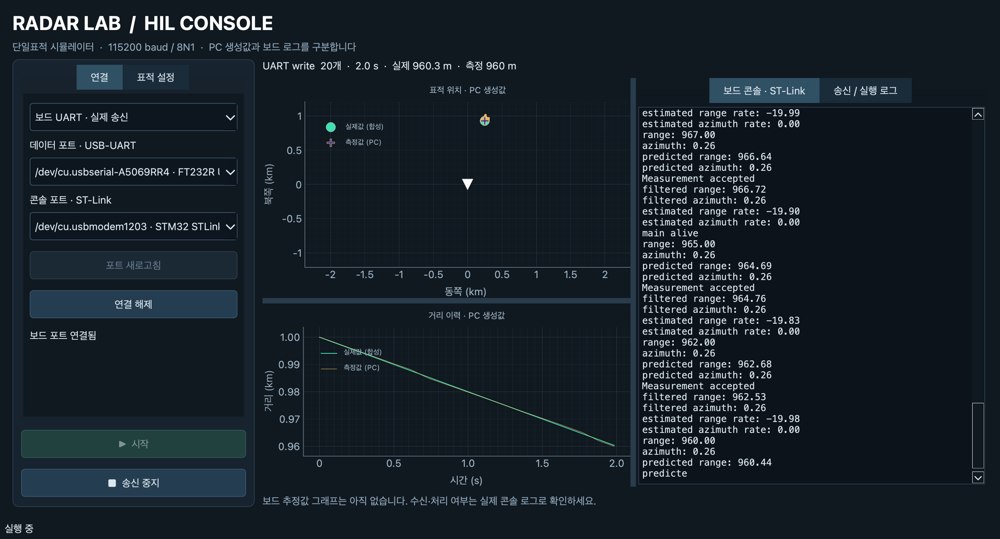

# 2026-11-01 실제 보드·GUI 검증

대상: `6a5cd7b` 이후 `rx_frame_processor.c/.h`로 parser 소유·큐 제출을 분리한 작업본.
STM32F746G-DISCO, Zephyr 4.2, CRC-16/IBM-3740, 115200 baud.
빌드 위치는 저장소 `build/`이며 OpenOCD로 플래시했습니다.

펌웨어 HEX SHA-256: `f5cbc260d96a15568a8254b64d794066e90a767cc32b003fd5503692c25afd50`.

## 검증 결과

| 구분 | 결과 |
| --- | --- |
| 펌웨어 | 빌드·플래시 성공 |
| Python | 74 passed, 9 subtests passed |
| UART host C | 분리된 실제 processor를 포함한 13개 통과 |
| 실제 GUI | 보드 연결, 송신, 그래프, INIT·추적 로그 확인 |
| GUI 중지 | 송신 개수 유지, timeout 1회 확인 |
| GUI 재시작 | 새 INIT·필터 초기화·측정 재개 확인 |
| GUI 종료 | 연결 해제·재연결·창 종료 시 worker 정리 확인 |
| 정상 프레임 | 20개 측정: 필터 초기화 1회, 보정 19회 |
| 수신 중단 | timeout 1회, 반복 없음 |
| 첫 측정 전 | INIT 후 1.3초 대기 중 timeout 없음 |
| CRC·길이 오류 | CRC 변조, LEN=0/33에서 측정 처리 없음; 각각 이후 정상 측정 처리 |
| RESET | reset 로그 확인, 후속 대기 중 timeout 없음 |
| 300프레임 burst | 큐 드롭 로그 발생, 이후 INIT·정상 측정 복귀 |

GUI 시험은 실제 PySide6 창과 실제 시리얼 포트를 사용했습니다. Qt 버튼 호출로
연결·시작·중지·재시작·종료를 자동 조작했고, 화면 캡처도 확인했습니다.
데이터 포트는 `/dev/cu.usbserial-A5069RR4`, 콘솔은 `/dev/cu.usbmodem1203`입니다.

그래프는 PC 합성값이며 보드 추정값 그래프가 아닙니다.

## 증거

- [GUI 보드 콘솔](test-results/2026-11-01/gui-console.log)
- [GUI 검사 결과](test-results/2026-11-01/gui-results.json)
- [오류·부하 시험 콘솔](test-results/2026-11-01/serial-smoke.log)
- [오류·부하 시험 결과](test-results/2026-11-01/serial-results.json)

## 한계와 후속 시험

- burst에서 메시지 큐 드롭은 관측했지만 소프트웨어 링버퍼 overflow 로그는 없었습니다.
  실제 drain 복구·UART 하드웨어 overrun 검증은 아직 남아 있습니다.
- 부하 중 RX 드롭 로그와 handler 로그가 일부 섞였습니다. 로그의 완전한 원자성을 보장하지 않습니다.
- INIT/RESET도 큐가 가득 차면 드롭될 수 있습니다.
- USART6 RX와 ST-Link 콘솔을 확인한 시험이며 USART6 TX 검증은 아닙니다.
- 장시간·최대 부하·정확한 timeout 지연·모든 스레드 경쟁 조건은 검증하지 않았습니다.
- 기존 device tree 중복 unit-address 경고는 유지됩니다.
