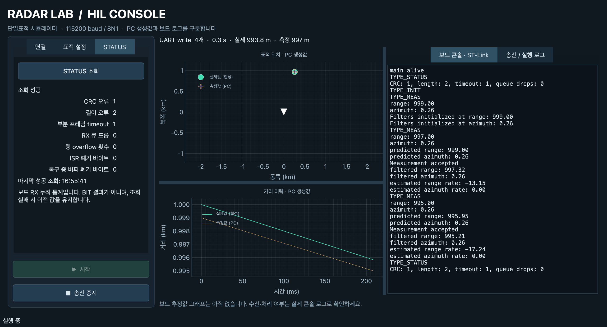

# 확장 STATUS 실보드 시험 — 2026-11-14

## 대상과 설정

- STM32F746G-DISCO, USART6 PC6 TX / PC7 RX, 115200 8N1.
- 소스는 `2f164bd` 이후 이 문서와 함께 커밋하는 STATUS 확장 작업본이다.
  [결과 JSON](test-results/status-extended-2026-11-14/normal/results.json)에 펌웨어 소스별 SHA-256, `.config`와 HEX 해시를 보존했다.
- 기본 `build`: DRAIN, 부분 프레임·측정 timeout 각각 1000ms, 게이트 100m/10°, assert 비활성.
- 일반 펌웨어 빌드 및 OpenOCD flash 성공. Flash 30,904 B, RAM 10,384 B.
  초기 Cortex-M 식별 오류 뒤 재탐색으로 Cortex-M7을 확인하고 flash를 완료했다.
- 데이터 `/dev/cu.usbserial-A5069RR4`, ST-Link 콘솔 `/dev/cu.usbmodem1203`.

## 결과

| 검증 | 결과 |
|---|---|
| UART 자동 판정 | 18개 모두 통과 |
| STATUS wire | TYPE=6, payload 28바이트 / 전체 33바이트, CRC 정상 |
| 초기·반복 조회 | 일곱 카운터 0, 반복 조회로 증가하지 않음 |
| 오류 주입 | CRC +1, 잘못된 LEN +2, 부분 프레임 timeout +1 |
| INIT/RESET | 위 누적 통계 보존 |
| 정상 측정 | 초기화 1회, 이후 측정 9개 수용 |
| 측정과 STATUS 병행 | 추적 지속, STATUS가 측정 무수신 기준 시각을 갱신하지 않음 |
| 무수신 | 첫 정상 측정 전 비감시, 측정 중단 후 timeout 1회 |
| 실제 CLI | 일곱 필드 수신·표시, 종료 코드 0 |
| 실제 GUI | 일곱 필드 표시, 측정 중·중지 후 조회, 창 닫기 후 worker/포트 정리 |

마지막 값은 CRC=1, length=2, frame timeout=1, queue drop=0,
ring overflow=0, ISR dropped bytes=0, recovery discarded bytes=0이다.
콘솔 텍스트는 기존 네 통계만 출력하며 일곱 필드 검증은 USART6 응답을 기준으로 한다.

## 증거와 재현

- [UART 판정·소스 해시](test-results/status-extended-2026-11-14/normal/results.json), [wire 재파싱](test-results/status-extended-2026-11-14/normal/wire-check.json)
- [원시 TX/RX 바이트](test-results/status-extended-2026-11-14/normal/traffic.json), [ST-Link 콘솔](test-results/status-extended-2026-11-14/normal/console.log)
- [CLI 출력](test-results/status-extended-2026-11-14/normal/cli.log), [GUI 판정](test-results/status-extended-2026-11-14/normal/gui-results.json), [GUI 콘솔](test-results/status-extended-2026-11-14/normal/gui-console.log)
- 실행한 [UART 스크립트](test-results/status-extended-2026-11-14/uart-check.py), [GUI 스크립트](test-results/status-extended-2026-11-14/gui-check.py) 원본을 보존한다.

스크립트는 당시 절대 경로·포트·출력 위치를 고정한 증거용 스냅샷이다. 재현 시 자신의
경로와 포트 및 새 출력 디렉터리로 수정한다. 보드를 재부팅/플래시하여 통계를 0으로 만든 후
UART 스크립트(`normal` 인자), `python -m pc_sim.status_client --port PORT --timeout 2`,
GUI 스크립트 순으로 실행한다. GUI 스크립트는 앞선 오류 주입 결과 1/2/1/0/0/0/0을 기대한다.
기존 증거 파일을 덮어쓰지 않는다.

## 검증 한계

- 새 UART 카운터 세 개는 정상 상태의 0 전송을 확인했다. 강제 링 overflow로 카운터가 증가하고 복구되는 실보드 시험은 하지 않았다. 증가·정책별 폐기량은 host RX 시험 범위다.
- 구형 16바이트 응답 호환은 Python 모사 시험이며 구형 펌웨어를 다시 플래시하지 않았다.
- UART 하드웨어 overrun/framing/parity, 큐 포화·최대 부하·장시간, 모든 IRQ 경쟁 조건은 제외했다.
- 마지막 보드 상태는 위 기본 일반 펌웨어다. GUI 종료 후 포트를 해제했다.
