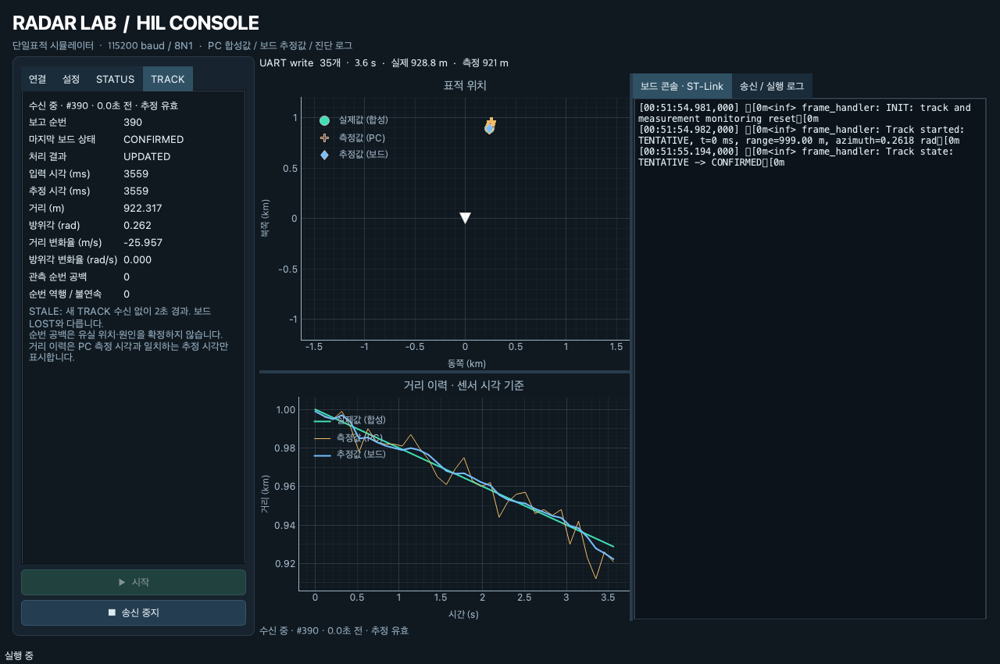

# CSV·추적 평가·GUI 실보드 검증 — 2026-11-18

대상은 `da6ffe5` 이후 오래된 측정 폐기·STATUS 확장 작업본입니다. 기준 commit 자체의 결과로 해석하지 않습니다.
[펌웨어 차이](test-results/evaluation-2026-11-18/firmware.patch)와 [소스·설정·HEX SHA-256](test-results/evaluation-2026-11-18/source-metadata.json)을 보존했습니다.
실행 후 공개 헤더 설명만 보완했으며 동작 변경 없이 최종 회귀를 수행했습니다.

## 환경과 검증

- STM32F746G-DISCO / Zephyr 4.2, USART6 PC6 TX·PC7 RX, 115200/8N1.
- 데이터 `/dev/cu.usbserial-A5069RR4`, GUI 콘솔 `/dev/cu.usbmodem11203`.
- 기본 DRAIN, 부분 프레임/측정 timeout 1000ms, 게이트 100m/10°, 일반 INFO, assert 비활성.
- 일반 빌드·OpenOCD flash 성공. FLASH 42,784 / RAM 15,696바이트. 보드는 이 일반 이미지로 유지했습니다.
- 디버그 빌드 성공: FLASH 58,784 / RAM 16,976바이트. 디버그 이미지는 이번에 플래시하지 않았습니다.
- Python 231개 + subtest 9개, C 논리 사례 116회(RX45·handler30·TX4·Tracking17+게이트20) 통과. CTest 등록 항목은 Tracking 묶음 때문에 100개입니다.
- 새 `stale_measurements`는 STATUS payload offset28에 추가했습니다. 현재 32바이트/전체37바이트이며 PC는 과거16/28바이트도 지원합니다.
- 큐 측정 나이의 임계값 직전/정확한 경계·추적/감시/순번 보존·포화·복귀는 host로 검증했습니다. 보드에 handler 지연을 강제로 주입한 시험은 아닙니다.

## 고정 시나리오 결과

seed42, 센서 시간축10Hz·120개, 초기1000m·-5m/s·고정15도입니다. normal 잡음0, noisy/dropout 거리 잡음 표준편차8m입니다.
dropout은 센서 시각 [4000,5500)ms의 15개 측정을 보내지 않습니다. 모든 시나리오 각도 잡음0이며 필터 튜닝을 바꾸지 않았습니다.
STARTED 이후 2초를 매번 제외하고 같은 추정 시각의 정답·양자화 측정값·보드 추정값을 비교했습니다.

| 시나리오 | 보낸 측정 | TRACK 수신 | RMSE 대응 표본 | 측정 거리 RMSE(m) | 추정 거리 RMSE(m) | PC RTT p95 / 최대(ms) |
|---|---:|---:|---:|---:|---:|---:|
| normal | 120 | 123 | 100 | 0.353553 | 0.047965 | 5.572 / 7.224 |
| noisy | 120 | 123 | 100 | 7.600987 | 2.739390 | 5.607 / 6.883 |
| dropout | 105 | 109 | 65 | 7.793735 | 2.870291 | 6.037 / 8.059 |

TRACK 개수에는 INIT·마지막 무수신 timeout·RESET 이벤트가 포함됩니다. dropout에는 중간 timeout 이벤트가 하나 더 있습니다.
각도 측정 RMSE는 약4.876e-10rad, 추정은7.285e-9rad였습니다. 고정 방위각 양자화/float 오차 수준이며 각도 기동·잡음에서의 성능 증거가 아닙니다.
세 실행 모두 순번 공백·불연속·대응 불가 추정·반복 추정 시각0입니다. STATUS 각2회에서 여덟 카운터 모두0이었습니다.
dropout의 STARTED는 센서 시각0과5500ms에서 나타나 timeout 뒤 새 트랙으로 복귀했음을 확인했습니다.

- [집계 JSON](test-results/evaluation-2026-11-18/summary.json), [상태·STATUS 확인](test-results/evaluation-2026-11-18/state-status-checks.json).
- 정상 [metadata](test-results/evaluation-2026-11-18/normal/20261118-204434-2e8a631c/metadata.json) · [측정](test-results/evaluation-2026-11-18/normal/20261118-204434-2e8a631c/samples.csv) · [보고](test-results/evaluation-2026-11-18/normal/20261118-204434-2e8a631c/reports.csv) · [wire](test-results/evaluation-2026-11-18/normal/20261118-204434-2e8a631c/wire.csv).
- 잡음 [측정](test-results/evaluation-2026-11-18/noisy/20261118-204449-320a8922/samples.csv) · [보고](test-results/evaluation-2026-11-18/noisy/20261118-204449-320a8922/reports.csv) · [wire](test-results/evaluation-2026-11-18/noisy/20261118-204449-320a8922/wire.csv).
- 연속 누락 [측정](test-results/evaluation-2026-11-18/dropout/20261118-204503-fa46e562/samples.csv) · [보고](test-results/evaluation-2026-11-18/dropout/20261118-204503-fa46e562/reports.csv) · [wire](test-results/evaluation-2026-11-18/dropout/20261118-204503-fa46e562/wire.csv).

## 실제 UART GUI

실제 PySide6 widgets와 SessionWorker를 offscreen Qt로 실행하고 실제 두 UART를 사용했습니다. 보드 응답 모사는 사용하지 않았습니다.
13개 확인 항목 통과: CONFIRMED·추정 곡선/위치, STATUS stale 카운터0, 1000×650 배치,
timeout 후 위치 제거·EMPTY, 2초 STALE에서도 마지막 상태 보존, 재시작 시 별도 CSV, 이전/종료 파일 정리와 시각 대응 평가입니다.

[1000×650 캡처](test-results/evaluation-2026-11-18/gui-track-small.png) · [STALE 캡처](test-results/evaluation-2026-11-18/gui-stale.png) · [13개 판정](test-results/evaluation-2026-11-18/gui-results.json) · [GUI CSV 평가](test-results/evaluation-2026-11-18/gui-evaluation.json).

GUI 첫 실행은 측정36개/보고38개, warm-up 이후16개 대응입니다. GUI의 기본 거리 변화율은 -20m/s이며 위 고정 CLI 시나리오와 다릅니다.
PC 왕복 최대67.385ms는 캡처·이벤트 처리·CSV 기록을 동반한 PC 관측값입니다. MCU20ms 지연 예산의 위반 또는 충족 여부를 판정하는 값이 아닙니다.
작은 창과 큰 창의 그래프/콘솔 배치를 검토했습니다. native 화면에서 사람이 직접 마우스로 조작한 시험은 아닙니다.

## 실패·재현·제한

- 첫 CLI 실행은 샌드박스에서 포트 접근이 거부됐습니다. 송수신 없는 [빈 normal 기록](test-results/evaluation-2026-11-18/normal/20261118-153423-7f9410fc/metadata.json)을 보존하며 성공 집계에서 제외합니다.
- GUI는 처음 두 번 연결 대기가 만료됐습니다. 실제 ST-Link 경로가 `usbmodem1203`에서 `usbmodem11203`으로 바뀌어 있었습니다. 현재 장치를 확인하고 스크립트 경로를 고친 뒤 통과했습니다. 펌웨어 실패로 분류하지 않습니다.
- `closed=true`는 파일 종료 여부입니다. 빈·부분·실패 실행의 합격 표시가 아닙니다. 실패 실행을 성공 지표에 합치지 않습니다.
- 재사용 도구: [CLI 명령과 CSV 설명](../pc_sim/README.md#csv-수집과-정량-평가). 증거용 [board-evaluate.py](test-results/evaluation-2026-11-18/board-evaluate.py), [gui-check.py](test-results/evaluation-2026-11-18/gui-check.py)는 당시 포트/출력 경로를 사용하므로 새 위치로 바꿔 실행하고 기존 증거를 덮어쓰지 않습니다.
- PC 왕복은 같은 monotonic 시계의 송신 직전~보고 수신입니다. USB·OS·read polling·기록 비용을 포함합니다. MCU 내부 큐 대기/처리시간과 다르며 최대값은 WCET 증명이 아닙니다.
- 실제 송신은 catch-up burst 없이 진행하므로 센서 시간축10Hz와 벽시계 송신률이 다릅니다. 누락 구간의 정답에 보간 추정을 만들어 평가하지 않았습니다.
- 강제 stale 큐·링 overflow·RX/TX 큐 포화·이번 버전의 물리 단선·30분 부하·스택 여유는 미검증입니다. STATUS0만으로 하드웨어 유실0을 증명하지 않습니다. v1 최종 완료는 아직 아닙니다.
