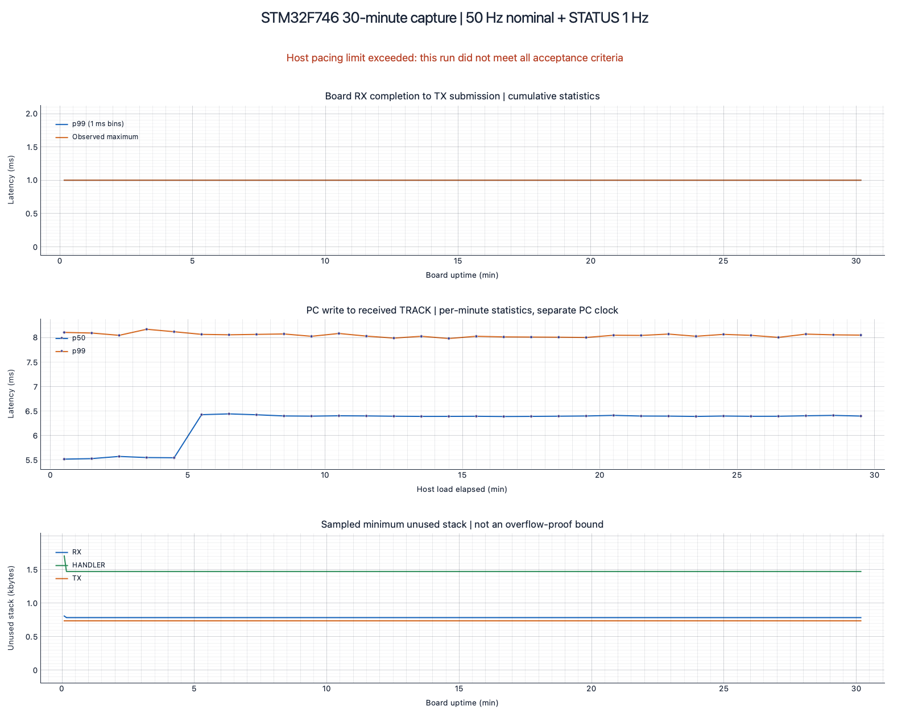

# 성능 계측 실보드 시험 — 2026-11-18

후속 [진행 집계 수정 후 재시험](hardware-test-2026-11-19-performance.md)을 별도로 기록했다. 이 문서의 이전 시험 판정은 변경하지 않는다.

대상 펌웨어는 `25c8bb9`의 STM32F746G-DISCO `perf.conf` 구성이다. 펌웨어 수정 없이 계측 이미지로 시험하고 일반 이미지를 복원한다. 시험 스크립트는 [board_check.py](../fcc_app/tests/test_perf_monitor/board_check.py)이며 세션별 metadata에 실제 ELF·스크립트 SHA-256을 기록한다.

## 고정 조건과 수용 기준

- 정지 표적: 거리 1,000m, 방위각 15°, 거리 변화율·센서 잡음 0.
- USART6: 115200 baud, 8N1. 측정 50Hz, STATUS 요청 1Hz, 목표 지속 시간 1,800초.
- MEAS_REPORT 15바이트, STATUS_REQUEST 6바이트, TRACK/STATUS_REPORT 각각 37바이트. 정상 부하의 방향별 wire 사용량은 약 RX 756B/s·TX 1,887B/s(각각 선로 용량의 6.6%·16.4%)다. 시작/종료 제어·timeout 보고는 별도로 집계한다.
- 호스트 유효 부하 기준: 평균 49.5..50.5Hz, 측정 write 간격 최대 100ms. 늦어진 송신 슬롯은 건너뛰고 개수를 보고하며 몰아서 전송하지 않는다.
- 보드 기준: 응답/통계 대응, CRC/LEN/timeout/링·큐 오류 0, RX 완료→TX 큐 제출 지연 최대 20ms 이하, 예상 밖 재부팅·로그 손실 없음, 연속된 계측 요약 및 세 스레드의 양수 스택 여유.
- 보드 시계는 정수 ms, PC 왕복은 같은 PC monotonic clock의 write 직전→수신 파싱 시각이다. 두 시계 값을 서로 빼지 않는다.

## 짧은 실보드 확인

[원시 결과와 26개 판정](test-results/perf-smoke-2026-11-18/results.json), [콘솔](test-results/perf-smoke-2026-11-18/console.log.gz), [계측 요약](test-results/perf-smoke-2026-11-18/performance.json).

10초 동안 정확히 500개를 50Hz로 송신했다. 무효 입력·RESET 이후 복귀 측정 3개까지 정상 측정 총503개가 모두 응답했다. 거리 0의 무효 측정 1개는 `without_submit=1`로 분리됐다. STATUS 요청/응답11개, TRACK508개(측정503 + 제어/timeout5), 총 송신 완료519개가 일치했다.

- 보드 RX 완료→TX 제출: p50 0ms, p95/p99 1ms, 관측 최대1ms, 20ms 초과0.
- PC 왕복: p50 5.497ms, p95 6.689ms, p99 8.161ms, 최대9.054ms.
- 관측 큐 최대: RX0, TX1. RX0은 처리 대기 소비자에게 직접 전달됐을 수 있는 관측값이며 무한 큐 여유를 뜻하지 않는다.
- 스택 미사용 최솟값: RX784B, handler1,472B, TX736B.
- 보드 STATUS 여덟 카운터·PC CRC/LEN·큐 제출 실패0. INIT/RESET·무수신 timeout이 측정 시간 표본을 추가하지 않았고 일반 이미지 복원 후 STATUS0을 확인했다.

## 중단된 첫 장시간 실행

[실패 결과](test-results/perf-load-2026-11-18/results.json)와 [USB 장치 제거/재등록 로그 발췌](test-results/perf-load-2026-11-18/usb-events.txt)를 보존한다. 부하 약145초, 측정 write7,230회에서 `SerialException: write failed: [Errno 6] Device not configured`로 종료됐다. PC에서 측정 응답7,229개와 초기 INIT 보고1개를 수신했고 마지막 측정 한 개는 응답하지 않았다. 마지막 write 간격176.343ms는 기준100ms를 초과했다.

macOS에서 22:43:55 USB-UART 제거, 22:43:56 재등록, 22:44:03 제거/재등록을 확인했다. 작업자가 컴퓨터를 옮기며 연결이 끊겼을 가능성을 알렸다. 따라서 USB 연결 중단 실행으로 분류하며 정상 지속 부하 통과로 인정하지 않는다. 보드 내부 지연 초과나 큐 오류가 관측된 것은 아니지만 이 사실이 연결 실패를 취소하지 않는다. 일반 이미지 복원·STATUS0 확인은 성공했다.

## 장시간 재시험

새 부팅·새 기록 디렉터리에서 같은 조건과 기준으로 1,800초 수집했다. **보드 처리·통신 대응 검사는 통과했지만 호스트 송신 간격 기준이 미달하여 전체 시험은 실패로 유지한다. V1-4를 완료 처리하지 않는다.**

[실시간 시험 판정](test-results/perf-load-2026-11-18-retry/results.json), [독립 wire/CSV 재검증](test-results/perf-load-2026-11-18-retry/offline-audit.json), [콘솔 원문](test-results/perf-load-2026-11-18-retry/console.log.gz), [362개 누적 요약](test-results/perf-load-2026-11-18-retry/performance.json.gz), [압축 파일 해시](test-results/perf-load-2026-11-18-retry/archive-manifest.json).

| 항목 | 관측 결과 |
|---|---|
| 실제 측정 송신/대응 응답 | 89,971 / 89,971, 시각과 순서 일치 |
| 평균 측정 송신률 | 49.9839Hz (50Hz 목표의 ±1% 범위) |
| 호스트 송신 슬롯 건너뜀 | 29개. 보드가 받은 프레임의 드롭과 구분 |
| 호스트 write 간격 최대 | 163.995ms, 100ms 초과1회 → 기준 미달 |
| TRACK 보고 수/순번 | 89,973개, 순번0..89,972 연속. 측정89,971 + INIT1 + timeout1 |
| STATUS 요청/응답 | 1,801 / 1,801; 여덟 카운터 모두0 |
| 보드 RX 큐 접수 | 91,773 = 측정89,971 + STATUS 요청1,801 + INIT1 |
| TX 큐 접수·polling 완료·PC 프레임 수 | 각각91,774 = TRACK89,973 + STATUS1,801 |
| PC wire 재파싱 | CRC/LEN 오류0, 남은 부분 프레임0 |
| PC→보드 / 보드→PC wire | 1,360,377B / 3,395,638B |
| 계측 요약 | 362개, 요약 간격의 단절 없음 |
| 실제 첫/마지막 측정 write 간격 | 1,799.980초; 시험 루프는1,800초 |

| 보드 시간 (정수 ms) | 표본 수 | p50 | p95 | p99 | 관측 최대 | >20ms |
|---|---:|---:|---:|---:|---:|---:|
| queue_wait | 89,971 | 0 | 0 | 1 | 1 | 0 |
| processing | 89,971 | 0 | 1 | 1 | 1 | 0 |
| rx_to_submit | 89,971 | 0 | 1 | 1 | 1 | 0 |

PC write→TRACK 수신 지연은 p50 **6.391ms**, p95 **6.641ms**, p99 **8.041ms**, 최대 **164.128ms**였다. 큰 PC 지연과 송신 간격은 보드 내부 지연1ms와 구분한다. 재시험에서는 USB 제거 오류가 없었지만 호스트 지연의 세부 원인(OS 스케줄링·시리얼 I/O·기록/진행 출력 중 어느 구간인지)은 아직 확정하지 않았다.

관측 큐 점유 최대는 RX0/TX1, 스택 미사용 최솟값은 RX784/handler1,472/TX736바이트였다. 마지막 세 값은 짧은 시험과 동일하다. main·로깅 스레드·ISR 스택은 이번 조회 대상이 아니다. 일반 이미지 복원과 STATUS0 응답을 확인했다.



그래프의 보드 값은 누적 통계, PC 곡선은 분별 p50/p99다. PC 최대164.128ms는 p99 곡선에 표시되지 않는 별도 극값이다. 그래프는 합격 증명이 아니라 기록 요약이다.

### 보존·재검증

CSV와 원시 콘솔·flash 로그는 gzip으로 무손실 압축했다. 원시 CRLF 개행도 그대로 보존한다. 압축 전후 바이트 동일성을 확인했으며 manifest에 원본/압축 SHA-256을 남겼다. 압축 상태에서도 다음 명령으로 wire/CSV 대응과 그래프를 재생성할 수 있다(저장소 루트에서 실행).

```sh
python docs/test-results/perf-load-2026-11-18-retry/audit_capture.py docs/test-results/perf-load-2026-11-18-retry
QT_QPA_PLATFORM=offscreen python docs/test-results/perf-load-2026-11-18-retry/plot_capture.py docs/test-results/perf-load-2026-11-18-retry /tmp/performance-summary.png
```

`offline-audit.json`의 passed는 기록 재파싱·대응 검사에만 적용한다. `results.json`의 전체 시험 실패를 덮어쓰지 않는다. 그래프 재생성에는 기존 GUI 의존성(PySide6/pyqtgraph)이 필요하다.

### 다음 조치

펌웨어 변경을 먼저 할 근거는 확인되지 않았다. PC 시험기의 송신 루프에서 시리얼 read/write, CSV flush, 진행 출력, sleep/기상 지연을 나눠 계측하고 100ms 초과의 위치를 확인한다. 원인을 수정한 뒤 같은 기준으로 재시험하거나, 지원 환경에서 의미 있는 부하 계약을 재정의할 경우 변경 사유와 기준을 **재시험 전에** 고정한다. 이번 실패 기록은 보존한다.

## 재현과 해석 한계

명령과 복원 절차는 [시험기 안내](../fcc_app/tests/test_perf_monitor/README.md#real-board-check), 측정 구간과 백분위 구간 의미는 [계측 계약](performance-monitoring.md)을 따른다. 모든 5초 요약은 부팅 이후 누적 통계이며 구간별 최대나 WCET가 아니다. 계측 비용을 포함한다. 큐 점유율·스택 사용량은 관측값이며 물리 마지막 비트 완료·상대 ACK·모든 하드웨어 오류를 보장하지 않는다. 이 정지 표적 조건은 기동/잡음·과부하 성능을 대표하지 않는다.
