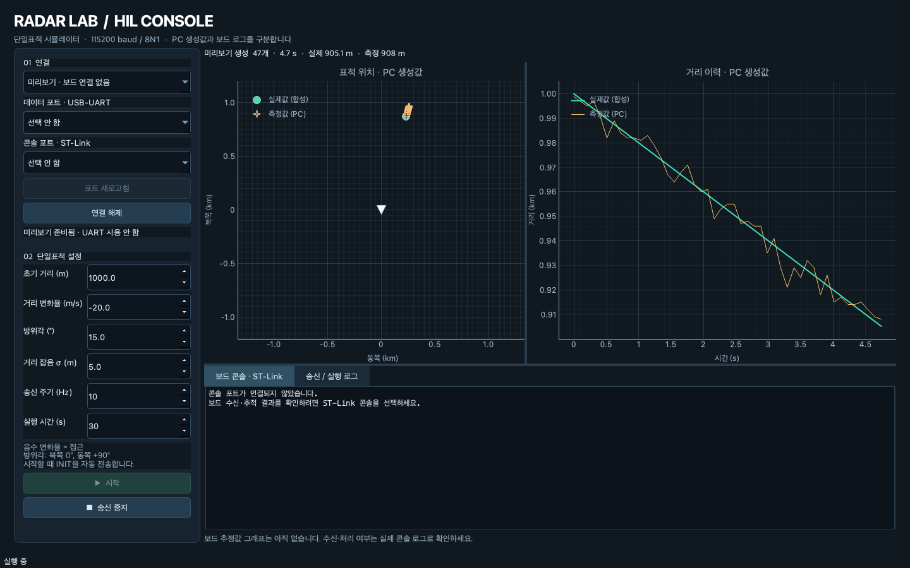
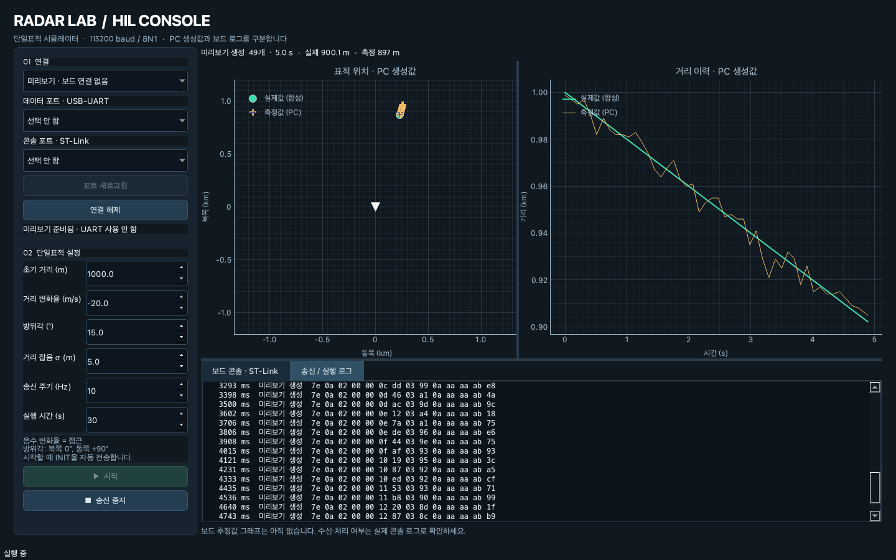

# Radar Lab GUI

기존 CLI와 같은 `protocol.py`로 INIT·측정 프레임을 만드는 PySide6/pyqtgraph 데스크톱 앱입니다.
펌웨어 변경 없이 단일표적 송신, PC 생성값 그래프, 실제 ST-Link 콘솔 확인에 사용합니다.

## 실제 앱 캡처

아래는 보드 없이 미리보기 모드로 실행한 실제 GUI입니다. PC 합성 데이터이며 보드 처리 결과 캡처가 아닙니다.





## 설치·실행

저장소 루트에서:

```sh
source ~/zephyrproject/.venv/bin/activate
python -m pip install -r pc_sim/requirements-gui.txt
python -m pc_sim.gui
```

GUI 의존성은 선택 사항입니다. 기존 CLI에는 PySide6/pyqtgraph가 필요하지 않습니다.
macOS에서는 설치할 Qt 버전이 지원하는 운영체제 버전을 사용해야 합니다.
이 작업 환경에서는 PySide6 6.12.0, pyqtgraph 0.14.0으로 검증했습니다.

## 보드 없이 보기

1. 기본 `미리보기` 모드에서 `미리보기 연결`을 누릅니다. 시리얼 포트를 열지 않습니다.
2. 초기 거리, 거리 변화율, 방위각, 거리 잡음, 송신 주기, 실행 시간을 설정합니다.
3. `시작`을 누르면 INIT 생성 후 실시간 속도로 측정을 생성합니다.
4. `송신 중지` 후 설정을 바꾸고 다시 시작할 수 있습니다.

음수 거리 변화율은 접근입니다. 방위각 입력 단위는 **도(°)**이며 내부에서 라디안과 semicircle로 변환합니다.
이는 int32 semicircle을 직접 받는 `radar_sender.py --azimuth`와 입력 단위가 다릅니다.
난수 seed는 42이며, 타임스탬프는 각 실행 시작 이후 PC monotonic 시계의 경과 시간입니다.
늦어진 송신을 몰아서 따라잡지 않으므로 실제 송신 주기는 설정값보다 느려질 수 있습니다.

## 실제 보드 사용

1. `보드 UART · 실제 송신`을 선택합니다.
2. 데이터 포트는 외부 USB-UART, 콘솔 포트는 ST-Link VCP를 선택합니다. 동일 포트는 허용하지 않습니다.
3. `보드 연결`을 누른 뒤 `시작`합니다. 시작마다 INIT을 한 번 전송합니다.
4. 콘솔에서 TYPE_INIT, 측정값, 필터 처리 로그를 확인합니다.
5. `송신 중지`는 새 측정 송신만 멈춥니다. 콘솔은 유지되므로 보드의 timeout 로그를 볼 수 있습니다.
6. `연결 해제` 또는 창 닫기는 작업 스레드 종료와 포트 해제를 수행합니다.

데이터와 콘솔은 모두 115200 baud, 8N1, 흐름제어 없음입니다.
별도 터미널·CLI가 같은 포트를 사용 중이면 먼저 해당 연결을 종료하세요.
콘솔 포트는 생략할 수 있지만 그 경우 보드가 데이터를 처리했는지 GUI에서 확인할 수 없습니다.
포트 열기·읽기·쓰기 오류는 실행 로그와 하단 상태줄에 표시합니다. 연결 오류 후 포트를 다시 선택해 재연결할 수 있습니다.
거리 또는 잡음이 wire 표현 범위를 벗어나면 값을 몰래 보정하지 않고 해당 실행을 중지합니다.

## 화면에서 확인할 수 있는 것

- 표적 위치: 합성 실제값과 최근 PC 측정값 100개. 북쪽 0°, 동쪽 +90°.
- 거리 이력: 최근 2000개 실제값·정수 양자화된 측정값. 축은 크기에 따라 m/km로 표시될 수 있습니다.
- 생성/송신 개수: 미리보기 생성 횟수 또는 serial write 완료 횟수입니다. 보드 수신 ACK가 아닙니다.
- 보드 콘솔: ST-Link에서 받은 실제 텍스트입니다. 추정값을 별도 파싱해 그래프에 표시하지 않습니다.
- 실행 로그: INIT, 측정 프레임, 중지·완료·오류. 각 로그 창은 최근 2000줄을 유지합니다.

현재 STATUS/BIT 응답, COMMAND, 다중표적, 보드 추정값 그래프, 로그 파일 저장은 구현하지 않았습니다.
이 GUI는 단일표적의 고정 방위각·일정 거리 변화율 시나리오입니다.
`run_sim.py`의 다중표적 시나리오 선택기는 포함하지 않습니다.

## 코드와 테스트

- `gui.py`: 화면·차트·사용자 조작.
- `gui_worker.py`: QThread에서 포트 소유, 송신 스케줄, 콘솔 읽기. GUI 갱신은 signal로 전달합니다.
- `gui_model.py`: 설정 검증·측정 생성. `protocol.py`의 wire 인코딩을 공유합니다.
- `tests/test_gui_model.py`: 단위·프레임·거리 경계·설정 검증.
- `tests/test_gui.py`: offscreen Qt에서 시작·중지·재시작·종료와 모사 serial의 INIT 순서·오류·포트 해제 검사.

```sh
python -m pytest tests/test_gui_model.py tests/test_gui.py -q
```

GUI 라이브러리가 없으면 Qt 테스트 모듈은 skip됩니다. 모사 serial 테스트는 실제 보드 통신 검증을 대신하지 않습니다.
Qt 실행 흐름은 [공식 QThread 문서](https://doc.qt.io/qtforpython-6/PySide6/QtCore/QThread.html)를 참고합니다.
